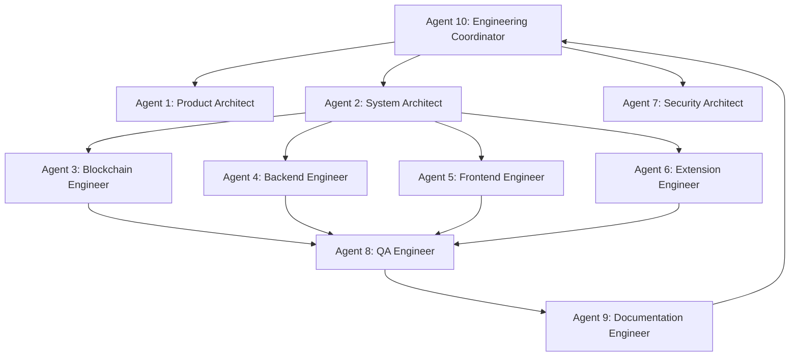

# AGENTS.md — Global Engineering Rules & Multi-Agent Governance

**Document ID:** LUC-GOV-000  
**Version:** 0.1.0  
**Status:** APPROVED  
**Last Updated:** 2026-11-09  

---

## 1. Core Operating Directive

You are operating inside the **LUCENTRA** repository as an engineering agent.

LUCENTRA is an independent verification layer for the internet that allows users and applications to verify website publisher identity and JavaScript resource integrity through cryptographic evidence.

Every AI agent, developer, and automated process operating in this repository must strictly adhere to the rules, constraints, and protocols defined in this document.

---

## 2. The Twenty Inviolable Engineering Rules

1. **Read Before Implementing:** Read the relevant documentation in `docs/` before implementing any feature, refactoring code, or modifying interfaces.
2. **Follow Approved Architecture:** Strictly follow the approved hybrid Web2/Web3 architecture. Do not alter component boundaries without an approved Architecture Decision Record (ADR).
3. **Never Invent Requirements:** Base all implementation on explicit requirements in `docs/01-product-management/`. If a requirement is ambiguous, document the ambiguity and request clarification.
4. **Never Introduce Unapproved Features:** Do not introduce scope creep, speculative features, or unsolicited third-party integrations.
5. **Never Expose Private Keys or Credentials:** No private keys, mnemonic phrases, API secrets, or credentials may ever be committed, logged, or hardcoded. Use environment variables and secret stores.
6. **Zero Backend Private Key Storage:** Never store publisher or witness private signing keys on the backend database or server memory. Private signing keys remain strictly in publisher hardware/software wallets (EIP-712).
7. **No Sensitive Data on Public Blockchains:** Never store personally identifiable information (PII), unhashed domain ownership tokens, or confidential data on Ethereum or public EVM networks.
8. **Use Established Cryptographic Standards:** Use strictly approved standards: SHA-256 (FIPS 180-4), EIP-712 structured hashing, secp256k1 ECDSA, and RFC 8785 JSON Canonicalization Scheme (JCS). No custom cryptography.
9. **Validate All External Input:** Validate all inputs at every boundary (REST endpoints, smart contract parameters, extension message passing, witness submissions) using strict schemas and type guards.
10. **Write Tests for Security-Sensitive Code:** Security-sensitive code (cryptography, authentication, contract state changes, extension origin checks) must have test coverage before merging.
11. **Keep Documentation Synchronized:** Update documentation immediately whenever behavior, endpoints, schemas, or contract interfaces change.
12. **Record Architecture Decisions:** Document significant architectural choices in `docs/03-architecture/decisions/` using the ADR template.
13. **Maintain Modular Boundaries:** Keep frontend, backend, smart contracts, extension, and witness components strictly modular and decoupled.
14. **Avoid Unnecessary Dependencies:** Evaluate every new third-party dependency for security vulnerabilities, audit status, and bundle weight before introducing it.
15. **Verify Implementation Claims:** Never claim a feature is implemented without inspecting the actual code and verifying its presence.
16. **Verify Test Claims:** Never claim tests passed unless they were actually executed in the environment and returned exit code 0.
17. **No Mainnet Deployments Without Explicit Approval:** Smart contracts may only be deployed to local testnets (Anvil) or public testnets (Sepolia) during development. Mainnet deployments require multi-stakeholder human sign-off.
18. **Inspect Before Modifying:** Never overwrite or replace existing files without first inspecting their contents, history, and dependencies.
19. **Decentralized Verification Truth:** Public APIs and client extensions must not treat the central backend database as an unquestioned single source of truth. Verification must rely on cryptographic signatures and on-chain EAS attestations.
20. **Preserve Protocol Compatibility:** Maintain backwards compatibility for releases and manifest formats according to `docs/04-protocol/PROTOCOL_VERSIONING.md`.

---

## 3. Implementation Status Taxonomy

To eliminate ambiguity across human and AI developers, all documentation, specifications, tickets, and code annotations must use the following lifecycle statuses:

| Status | Definition | Criteria for Transition |
| :--- | :--- | :--- |
| **PROPOSED** | Design or feature submitted for review. | RFC or ADR drafted in docs. |
| **APPROVED** | Formally accepted by Product/System Architect. | Signed off in ADR or product backlog. |
| **IN_PROGRESS** | Active development underway. | Assigned branch and active work. |
| **IMPLEMENTED** | Code written and merged to feature branch. | Code present in repository. |
| **TESTED** | Unit and integration tests passing. | Automated test suite execution verified. |
| **VERIFIED** | Acceptance criteria met in end-to-end environment. | Formal QA and security validation passed. |
| **DEPRECATED** | Superseded or scheduled for removal. | Migration path documented. |

---

## 4. Multi-Agent Governance & Specialization

When operating as specialized AI agents, tasks must align strictly with the responsibilities outlined below. Cross-functional modifications must follow the handoff protocol in `docs/15-ai-agent-governance/AGENT_HANDOFF_PROTOCOL.md`.

### Agent Roles Matrix

1. **Agent 1 — Product Architect:** Scope control, requirements definition, user story maintenance, feature gating.
2. **Agent 2 — System Architect:** System topology, data flow, trust boundary enforcement, ADR authority.
3. **Agent 3 — Blockchain Engineer:** EVM contracts (Solidity), Foundry tests, EIP-712 typing, EAS schemas, gas optimization.
4. **Agent 4 — Backend Engineer:** Django REST Framework, PostgreSQL schema, Celery tasks, DNS verification, witness ingestion.
5. **Agent 5 — Frontend Engineer:** Next.js dashboard, Wagmi/Viem wallet integration, verification reporting UI, Tailwind styling.
6. **Agent 6 — Browser Extension Engineer:** Manifest V3 background service worker, content scripts, DOM resource inspection, Web Worker hashing.
7. **Agent 7 — Security Engineer:** Threat modeling, attack surface minimization, smart contract formal verification, extension sandbox auditing.
8. **Agent 8 — QA Engineer:** Test harness maintenance, end-to-end integration tests, regression verification, test vector execution.
9. **Agent 9 — Documentation Engineer:** Documentation architecture, cross-reference validation, status tracking, release notes.
10. **Agent 10 — Engineering Coordinator:** Dependency mapping, task assignment, conflict resolution, handoff gating.

---

## 5. Context Loading & Token Optimization Policy

To preserve context window efficiency and prevent hallucinations:
1. **Never load the entire repository into agent context.**
2. **Selective Reading:** Load only this file (`AGENTS.md`), the relevant component design document in `docs/`, and the immediate source files under inspection.
3. **Targeted Diffs:** Work with surgical file edits rather than rewriting large source files.
4. **No Speculative Search Loops:** Use explicit file paths and targeted grep commands. Avoid recursive broad searches.

---

## 6. Verification and Acceptance Checklist

Before any agent marks a task complete:
- [ ] Code strictly implements the approved specification.
- [ ] No private keys or secrets are introduced.
- [ ] Security implications have been evaluated against `docs/11-security/THREAT_MODEL.md`.
- [ ] Automated tests have been executed and passed.
- [ ] Documentation has been updated to reflect any modified behavior.
- [ ] Status is accurately marked according to the status taxonomy.

