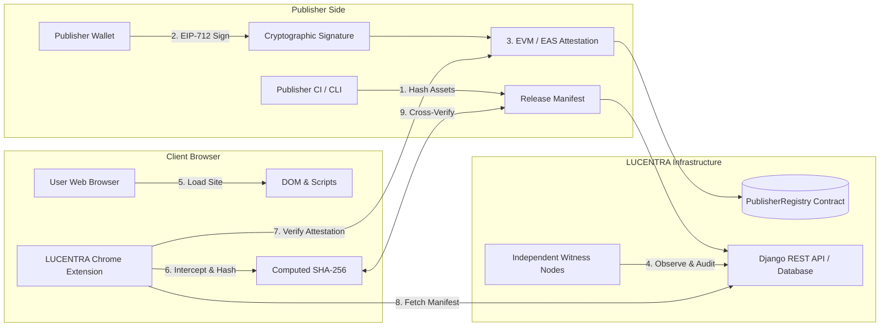

# LUCENTRA — Trust, Made Verifiable

LUCENTRA is an independent verification layer for the internet that allows users and web applications to cryptographically verify website publisher identity and JavaScript resource integrity.

---

## 1. The Core Problem

Modern web security relies heavily on HTTPS (TLS), which encrypts data in transit between the client and the server. However:
- **HTTPS does not verify content release authorization:** An attacker who compromises a CDN, an S3 bucket, a DNS registrar, or a hosting server can inject malicious JavaScript while maintaining a valid HTTPS certificate (e.g., British Airways Magecart attack).
- **Subresource Integrity (SRI) limitations:** SRI is host-controlled. If the primary HTML document is tampered with or served dynamically by an attacker, the `<script integrity="...">` attribute can simply be omitted or rewritten.
- **Supply chain vulnerabilities:** Modern single-page applications dynamically pull hundreds of third-party dependencies. Users have no independent mechanism to determine if the code running in their browser represents a publisher-authorized release.

LUCENTRA solves this by decoupling **integrity verification** from the hosting infrastructure through **cryptographic release manifests, Ethereum Attestation Service (EAS) attestations, domain-key registries, and independent witness networks**.

---

## 2. High-Level Architecture

LUCENTRA employs a hybrid Web2/Web3 architecture:

---

## 3. Approved Technology Stack

| Layer | Technology | Purpose |
| :--- | :--- | :--- |
| **Browser Extension** | Chrome Manifest V3, TypeScript, Web Workers | DOM inspection, script SHA-256 calculation, verification badge |
| **Publisher Dashboard** | Next.js 14, React, TypeScript, Tailwind CSS | Publisher onboarding, domain DNS verification, release management |
| **Blockchain Integration** | Viem, Wagmi, EIP-712 | Browser-side signing and smart contract interaction |
| **Backend & Ingestion** | Python 3.11+, Django 5+, Django REST Framework | Metadata caching, DNS validation worker, witness aggregation |
| **Asynchronous Queue** | Redis, Celery | Background resource crawling, witness polling, DNS TXT check |
| **Smart Contracts** | Solidity 0.8.24+, Foundry, OpenZeppelin | `PublisherRegistry.sol`, key lifecycle management |
| **Attestation Protocol** | Ethereum Attestation Service (EAS) | Immutable, publicly verifiable on-chain release attestations |
| **Cryptography** | SHA-256 (FIPS 180-4), RFC 8785 (JCS), secp256k1 | Deterministic canonicalization and asset hashing |

---

## 4. Current Implementation Status

> **Important Notice:** The project is currently in the **Architectural & Formal Engineering Documentation Phase**. No production application code or smart contracts have been deployed to mainnet. All functional components are strictly categorized in accordance with [DEVELOPMENT_STATUS.md](docs/14-project-management/DEVELOPMENT_STATUS.md).

- **Documentation Architecture:** COMPLETE (Status: APPROVED)
- **Smart Contracts:** SPECIFIED (Status: APPROVED specification, PLANNED implementation)
- **Backend API:** SPECIFIED (Status: APPROVED specification, PLANNED implementation)
- **Chrome Extension:** SPECIFIED (Status: APPROVED specification, PLANNED implementation)
- **Frontend Dashboard:** SPECIFIED (Status: APPROVED specification, PLANNED implementation)

---

## 5. Repository Documentation Directory Structure

For comprehensive engineering specifications, navigate the `docs/` tree:

- [docs/00-project-overview/](docs/00-project-overview/PROJECT_OVERVIEW.md) — High-level vision, problem statement, scope, and glossary.
- [docs/01-product-management/](docs/01-product-management/PRODUCT_REQUIREMENTS.md) — Requirements, user stories, and acceptance criteria.
- [docs/02-research-and-analysis/](docs/02-research-and-analysis/PROBLEM_RESEARCH.md) — Competitive analysis, Magecart research, RFC 8785 / SRI analysis.
- [docs/03-architecture/](docs/03-architecture/SYSTEM_ARCHITECTURE.md) — System topology, trust boundaries, data flows, and Architecture Decision Records (ADRs).
- [docs/04-protocol/](docs/04-protocol/PROTOCOL_SPECIFICATION_V0.1.md) — Canonicalization (RFC 8785), manifest schema, and state transitions.
- [docs/05-cryptography/](docs/05-cryptography/CRYPTOGRAPHIC_ARCHITECTURE.md) — EIP-712 typing, SHA-256 pipeline, key rotation, and replay protection.
- [docs/06-blockchain/](docs/06-blockchain/BLOCKCHAIN_ARCHITECTURE.md) — Solidity contracts, Foundry setup, and EAS schema definitions.
- [docs/07-backend/](docs/07-backend/BACKEND_ARCHITECTURE.md) — Django models, DRF endpoints, Celery workers, and database schemas.
- [docs/08-frontend/](docs/08-frontend/FRONTEND_ARCHITECTURE.md) — Next.js architecture, Wagmi hooks, and UI flows.
- [docs/09-browser-extension/](docs/09-browser-extension/EXTENSION_ARCHITECTURE.md) — Manifest V3 architecture, service worker, content scripts, and resource interception.
- [docs/10-witness-network/](docs/10-witness-network/WITNESS_ARCHITECTURE.md) — Multi-party witness protocol, observation formatting, and conflict resolution.
- [docs/11-security/](docs/11-security/SECURITY_OVERVIEW.md) — Threat model (STRIDE), attack surface analysis, and security checklists.
- [docs/12-testing/](docs/12-testing/TESTING_STRATEGY.md) — Test matrices across unit, integration, Foundry, and browser tests.
- [docs/13-devops/](docs/13-devops/DEVELOPMENT_ENVIRONMENT.md) — Local development, Docker, CI/CD, and deployment.
- [docs/14-project-management/](docs/14-project-management/DEVELOPMENT_ROADMAP.md) — Roadmaps, sprints, risk registers, and decision logs.
- [docs/15-ai-agent-governance/](docs/15-ai-agent-governance/MASTER_AGENT_INSTRUCTIONS.md) — AI agent rules, context optimization, and handoff protocols.
- [docs/16-user-and-developer-guides/](docs/16-user-and-developer-guides/QUICK_START.md) — Getting started guides for publishers and developers.
- [docs/17-releases/](docs/17-releases/VERSION_0.1.md) — Release notes and version specifications.
- [docs/DOCUMENTATION_INDEX.md](docs/DOCUMENTATION_INDEX.md) — Global documentation catalogue.

---

## 6. Development & Contributing

All contributors and AI agents must review:
1. [AGENTS.md](AGENTS.md) — Global rules of engagement and agent governance.
2. [CONTRIBUTING.md](CONTRIBUTING.md) — Contribution process and branching model.
3. [SECURITY.md](SECURITY.md) — Vulnerability reporting and security policies.

---

## 7. License

LUCENTRA is licensed under the MIT License. See [LICENSE](LICENSE) for details.
