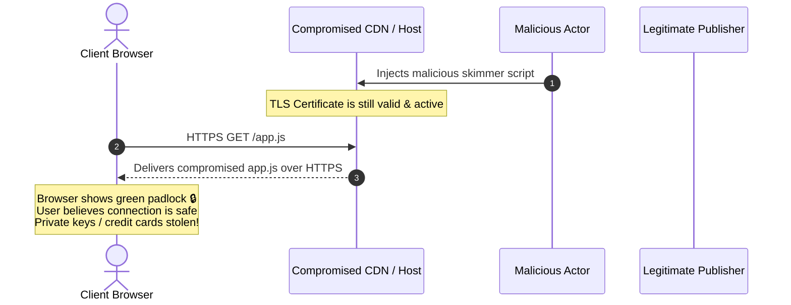

# Problem Statement — LUCENTRA

**Document ID:** LUC-OVR-003  
**Version:** 0.1.0  
**Status:** APPROVED  
**Last Updated:** 2026-11-09  

---

## 1. Purpose

This document details the fundamental structural and security flaws in modern web architecture that LUCENTRA is engineered to resolve.

---

## 2. Scope

Focuses on the threat landscape of client-side web delivery, HTTPS limitations, Subresource Integrity (SRI) deficiencies, client-side supply chain vulnerabilities (Magecart, CDN compromise), and decentralized frontend tampering.

---

## 3. The Core Problem Breakdown

### 3.1 Transport Encryption vs. Content Provenance
Internet users cannot independently establish whether JavaScript resources received from a website match a release authorized by its registered publisher. 

**HTTPS alone does not prove that website content matches a publisher-authorized release.**
- HTTPS guarantees **confidentiality and integrity in transit** between the client and the endpoint presenting a valid TLS certificate.
- HTTPS does **not** guarantee that the origin server itself has not been breached, that an S3 hosting bucket was not overwritten, that a CDN edge worker was not poisoned, or that an insider did not inject unvetted code.

### 3.2 The Failure of Subresource Integrity (SRI)
W3C Subresource Integrity (SRI) was introduced to allow web pages to specify hashes for third-party scripts:
``

However, SRI suffers from three fatal architectural shortcomings:
1. **Host-Controlled Integrity Attribute:** SRI is specified inside the top-level HTML document. If an attacker compromises the web host or root HTML, they simply delete or replace the `integrity` attribute.
2. **First-Party Script Omission:** Most modern web applications do not use SRI for their own first-party application bundles because dynamic cache-busting and rapid deployments make static HTML updates difficult.
3. **No Publisher Identity Binding:** SRI validates that a file matches a hash string, but gives the browser zero information about *who* created that hash string or whether that entity is authorized by the domain owner.

### 3.3 The Decentralized Finance (DeFi) & Web3 Frontend Vulnerability
In Web3, while smart contracts are immutable and audited, the frontend websites through which users interact with contracts (Curve, BadgerDAO, Balancer, Ledger Connect Kit) are hosted on standard Web2 infrastructure (Vercel, Cloudflare, AWS).
- In the **Ledger Connect Kit attack (Dec 2023)**, a compromised npm credential allowed attackers to inject a malicious wallet drainer into a widely used CDN script, compromising dozens of dApps simultaneously.
- In the **BadgerDAO attack (Dec 2021)**, an API key compromise on Cloudflare allowed attackers to inject malicious script into the frontend, draining over \$120M from users.

---

## 4. Problem Resolution Criteria

To solve this problem conclusively, LUCENTRA must provide:
1. **Domain-to-Publisher Identity Verification:** A verifiable, cryptographic link between a DNS domain and an authorized signing identity.
2. **Cryptographically Signed Release Manifests:** An immutable, structured list of authorized files and their exact SHA-256 digests.
3. **Independent Client-Side Resource Verification:** A browser extension that inspects, hashes, and validates code in real-time.
4. **Publicly Verifiable EVM Attestations:** Release hashes anchored on public ledgers via EAS.
5. **Independent Witness Observations:** Multi-location auditing to prevent targeted or split-view attacks.
6. **Transparent Verification Reports:** Clear, actionable, cryptographic evidence surfaced directly to end-users.

---

## 5. Security Implications

Failing to solve this problem leaves modern web applications vulnerable to catastrophic client-side attacks, credential theft, and unauthorized fund transfers.

---

## 6. Known Limitations

Websites that continuously inject unversioned, dynamic inline scripts or arbitrary third-party ad networks will encounter verification failures unless those scripts are properly isolated or excluded from release manifests.

---

## 7. Related Documents

- [docs/00-project-overview/PROJECT_SCOPE.md](PROJECT_SCOPE.md)
- [docs/02-research-and-analysis/PROBLEM_RESEARCH.md](../02-research-and-analysis/PROBLEM_RESEARCH.md)
- [docs/02-research-and-analysis/COMPETITOR_ANALYSIS.md](../02-research-and-analysis/COMPETITOR_ANALYSIS.md)

---

## 8. References

- [US CISA Advisory on Web Skimming and Magecart Attacks](https://www.cisa.gov/)
- [W3C Subresource Integrity Recommendation](https://www.w3.org/TR/SRI/)
- [Ledger Connect Kit Security Incident Post-Mortem (2023)](https://www.ledger.com/)
