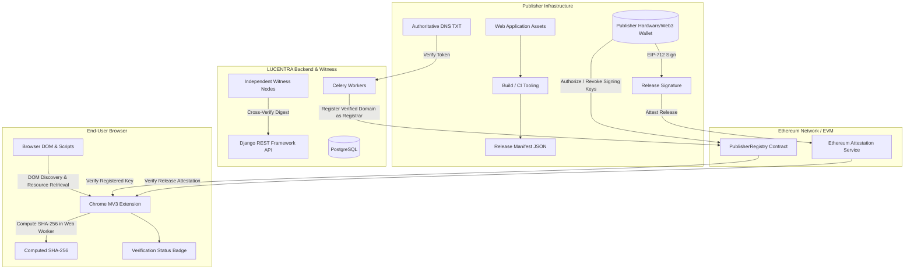

# Project Overview — LUCENTRA

**Document ID:** LUC-OVR-001  
**Version:** 0.1.0  
**Status:** APPROVED  
**Last Updated:** 2026-11-09  

---

## 1. Purpose

This document provides the foundational engineering overview of **LUCENTRA**, detailing its mission, architecture, components, and operating context as an internet authenticity and verification infrastructure.

---

## 2. Scope

Covers the end-to-end system topology across the Chrome Manifest V3 extension, Next.js publisher dashboard, Django REST Framework backend API, Ethereum smart contracts (`PublisherRegistry.sol`), Ethereum Attestation Service (EAS) attestations, and independent witness observer network.

---

## 3. Executive Technical Explanation

LUCENTRA bridges the gap between web transport security (HTTPS/TLS) and application release integrity. While HTTPS guarantees that traffic between a browser and a server is encrypted and authenticated at the domain level, it does not guarantee that the JavaScript files delivered to a client represent code that was vetted, authorized, and signed by the verified publisher of that domain.

Attacks such as Magecart, BGP hijacks, CDN account takeovers, internal server compromises, and malicious third-party script injections bypass HTTPS completely because the malicious payload is served over a valid TLS session.

LUCENTRA introduces a multi-tier cryptographic integrity protocol:
1. **Publisher Identity Binding:** Publishers prove domain ownership via DNS TXT record verification, after which an authorized Registrar submits the on-chain binding in `PublisherRegistry.sol`.
2. **Release Manifest Authorization:** Publishers compile a deterministic JSON release manifest containing exact SHA-256 digests of all production JavaScript assets.
3. **EIP-712 Signing:** Publishers sign the manifest digest using their verified private key.
4. **On-Chain Attestation:** Releases are anchored on-chain via the Ethereum Attestation Service (EAS) with explicit revocation semantics.
5. **Client-Side Browser Verification:** A lightweight Chrome Manifest V3 extension discovers scripts in the DOM, fetches resource streams out-of-band to compute SHA-256 hashes, validates against the publisher's signed release manifest and on-chain EAS attestation, and cautions the user if an unverified or altered resource is detected.
6. **Witness Audit Layer:** Independent witness nodes periodically crawl registered domains, compute live resource hashes, and log cryptographic observations to prevent localized or targeted tampering (split-view attacks).

---

## 4. System Components Matrix

| Component | Repository Subsystem | Tech Stack | Primary Responsibility |
| :--- | :--- | :--- | :--- |
| **Browser Extension** | `apps/extension` | Chrome MV3, TS, Web Workers | Inspects scripts in DOM, hashes files, verifies EAS attestation. |
| **Publisher Dashboard** | `apps/dashboard` | Next.js 14, Tailwind, Wagmi/Viem | Domain ownership challenge, manifest generation, EIP-712 signing. |
| **Backend API** | `services/backend` | Python 3.11+, Django, DRF, Celery | DNS TXT verification, manifest indexing, witness data aggregation. |
| **Smart Contracts** | `contracts/` | Solidity 0.8.24, Foundry, OpenZeppelin | Domain-to-address registry, key lifecycle, EAS schema hooks. |
| **Witness Node** | `services/witness` | Python / Go daemon | Independent verification, split-view detection, observation signing. |

---

## 5. Dependencies

- **Cryptographic Primitives:** SHA-256 (FIPS 180-4), secp256k1, RFC 8785 JSON Canonicalization.
- **EVM Infrastructure:** Ethereum Sepolia (testnet) and Ethereum Mainnet / Arbitrum One (L2 target).
- **Public Standards:** EIP-712 (Typed Structured Data), EAS (Ethereum Attestation Service), RFC 1035 (DNS).

---

## 6. Security Implications

- **Decentralized Trust:** Client verification does not treat the central backend API as a root of trust. If the backend is compromised, it cannot produce valid cryptographic signatures for rogue scripts.
- **Key Custody:** Publisher private signing keys are strictly non-custodial and never touch LUCENTRA backend servers.
- **Threat Vector Mitigation:** Directly addresses supply chain injection, unauthorized script substitution, and DNS hijacking attacks.

---

## 7. Known Limitations & Verification Boundaries

- **Exact Execution vs. Retrieval Boundary:** The Chrome Extension retrieves discovered resources out-of-band and verifies their hashes against the publisher's attested manifest. It does not inspect in-memory V8 engine execution bytes or JIT compiled bytecode.
- **Inline Script Parsing:** Complex inline dynamic scripts require nonce/hash hashing or CSP-level integration; currently, external and bundled static scripts form the primary verification scope for MVP.
- **MV3 Pre-execution Blocking:** Manifest V3 limits synchronous blocking of network requests without enterprise policy; the extension uses DOM mutation observers and out-of-band script inspection.

---

## 8. Related Documents

- [docs/00-project-overview/PRODUCT_VISION.md](PRODUCT_VISION.md)
- [docs/00-project-overview/PROBLEM_STATEMENT.md](PROBLEM_STATEMENT.md)
- [docs/03-architecture/SYSTEM_ARCHITECTURE.md](../03-architecture/SYSTEM_ARCHITECTURE.md)
- [docs/04-protocol/PROTOCOL_SPECIFICATION_V0.1.md](../04-protocol/PROTOCOL_SPECIFICATION_V0.1.md)

---

## 9. References

- [Ethereum Attestation Service Documentation](https://docs.attest.org/)
- [EIP-712: Typed structured data hashing and signing](https://eips.ethereum.org/EIPS/eip-712)
- [RFC 8785: JSON Canonicalization Scheme (JCS)](https://www.rfc-editor.org/rfc/rfc8785.html)
- [W3C Subresource Integrity (SRI)](https://www.w3.org/TR/SRI/)

