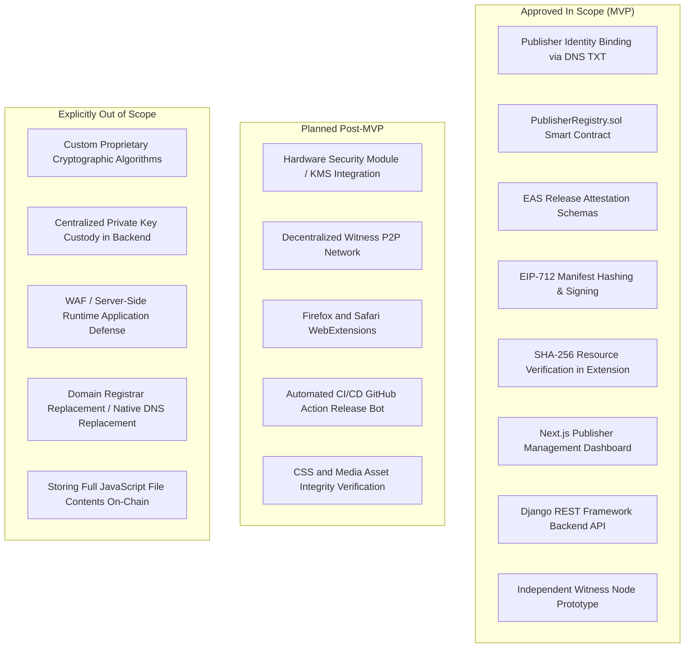

# Project Scope — LUCENTRA

**Document ID:** LUC-OVR-004  
**Version:** 0.1.0  
**Status:** APPROVED  
**Last Updated:** 2026-11-09  

---

## 1. Purpose

This document formally delineates the technical, architectural, and operational boundaries of LUCENTRA. It explicitly defines what is within scope for the Minimum Viable Product (MVP), what is planned for subsequent releases, and what is strictly out of scope.

---

## 2. Scope Matrix

---

## 3. Approved MVP Deliverables

The approved MVP focuses strictly on **Publisher Identity Verification + Signed JavaScript Integrity Verification**.

### 3.1 Delivery Subsystems

1. **Chrome Extension (Manifest V3):**
   - Content script DOM inspection for `<script src="...">` tags.
   - Non-blocking Web Worker computing SHA-256 digests.
   - Background service worker querying backend/EAS for active release manifest.
   - Verification status badge and popup UI evaluating the six honest verification states: `VERIFIED_RELEASE_MATCH`, `UNVERIFIED_RESOURCE_DETECTED`, `UNREGISTERED_PUBLISHER`, `UNATTESTED_RELEASE`, `REVOKED_RELEASE`, and `INDETERMINATE`.
   - *Verification Scope Boundary:* Verifies independently fetched resource bytes against signed manifests; explicitly does not claim to inspect exact in-memory V8 engine execution bytes or inline eval strings.

2. **Publisher Management Dashboard (Next.js):**
   - Web3 wallet connection (MetaMask, Rainbow, WalletConnect via Wagmi).
   - Domain addition and DNS TXT challenge generation (`_lucentra-verification.<domain>`).
   - Release creation interface: drag-and-drop bundle directory or asset URL listing.
   - Deterministic RFC 8785 canonical manifest compilation.
   - EIP-712 client-side signing request.
   - On-chain attestation submission via EAS.

3. **Backend API (Django REST Framework):**
   - Publisher profile and domain registry indexing.
   - Asynchronous DNS TXT record validation via Celery.
   - Automated Registrar transaction submission to `PublisherRegistry.sol` upon successful DNS TXT record validation.
   - Release manifest metadata storage and serving.
   - Witness observation ingestion endpoint.
   - Health check and telemetry endpoints.

4. **Smart Contracts (Solidity & Foundry):**
   - `PublisherRegistry.sol`: Maps normalized domains to publisher Ethereum addresses via authorized Registrar initial registration, enforces domain owner-only key rotation and revocation, and emits auditable registration events.
   - EAS Schema registration: Defines structured attestation schema for release digests.

5. **Independent Witness Client:**
   - Standalone CLI/daemon that crawls authorized domains, hashes JavaScript files, cross-references with EAS attestations, and submits cryptographically signed observations.

---

## 4. Explicitly Out of Scope

1. **Private Key Generation or Custody:** LUCENTRA will never manage, store, or hold private keys for publishers or witnesses.
2. **On-Chain Full File Storage:** Storing full JavaScript bundles on Ethereum is cost-prohibitive; only cryptographic hashes (SHA-256 digests and root merkle/manifest hashes) are anchored on-chain.
3. **Automated Code Vulnerability Scanning:** LUCENTRA verifies **authenticity and integrity** (whether code matches the publisher's authorized release), not whether the publisher wrote secure or bug-free code.
4. **In-Memory V8 JIT Byte Execution Verification:** Browser extension architecture and web security boundaries cannot intercept or cryptographically verify exact V8 JIT memory or dynamically evaluated strings without deep browser engine modifications.

---

## 5. Dependencies & Security Implications

Clear scope boundaries prevent feature creep and ensure that the security model remains auditable and formally verifiable.

---

## 6. Known Limitations

Ad networks and analytics providers that modify script content dynamically on every HTTP request are incompatible with static SHA-256 matching and must be isolated into untracked domains or sandboxed iframes.

---

## 7. Related Documents

- [docs/01-product-management/MVP_FEATURES.md](../01-product-management/MVP_FEATURES.md)
- [docs/01-product-management/OUT_OF_SCOPE.md](../01-product-management/OUT_OF_SCOPE.md)
- [docs/03-architecture/SYSTEM_ARCHITECTURE.md](../03-architecture/SYSTEM_ARCHITECTURE.md)

---

## 8. References

- [Ethereum Attestation Service Specification](https://docs.attest.org/)
- [Google Chrome Extensions Manifest V3 Guidelines](https://developer.chrome.com/docs/extensions/mv3/intro/)

