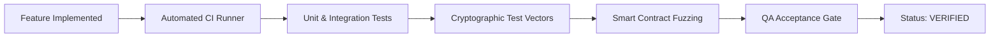

# Global Acceptance Criteria — LUCENTRA

**Document ID:** LUC-PRD-009  
**Version:** 0.1.0  
**Status:** APPROVED  
**Last Updated:** 2026-11-09  

---

## 1. Purpose

This document establishes the measurable, non-negotiable acceptance criteria for verifying that features, user stories, and technical implementations meet LUCENTRA's standards for security, determinism, and usability.

---

## 2. Core Subsystem Acceptance Gates

### 2.1 Domain Verification Acceptance Criteria (GATE-DNS)
- **CRIT-DNS-01:** Challenge tokens must be randomly generated using `secrets.token_hex(32)` (256-bit entropy).
- **CRIT-DNS-02:** Backend must query authoritative nameservers directly using `dnspython` to avoid stale public resolver caching.
- **CRIT-DNS-03:** Verification must require exact domain string match following UTS #46 normalization (e.g., `EXAMPLE.COM` normalized to `example.com`).
- **CRIT-DNS-04:** Successful verification must sign a time-bound authorization payload that allows the publisher to call `registerDomain` on `PublisherRegistry.sol`.

### 2.2 Manifest & Cryptography Acceptance Criteria (GATE-CRYPTO)
- **CRIT-CRY-01:** Release manifest serialization must strictly match RFC 8785 JSON Canonicalization Scheme (JCS).
- **CRIT-CRY-02:** Cross-language test vectors in TypeScript, Python, and Go must produce identical SHA-256 byte hashes for the same input manifest data.
- **CRIT-CRY-03:** EIP-712 structured data signing must validate against the exact domain separator and type hash definitions in `docs/05-cryptography/EIP712_SIGNING.md`.
- **CRIT-CRY-04:** All file hashes must use SHA-256 (FIPS 180-4) encoded as lowercase hexadecimal strings prefixed with `sha256:`.

### 2.3 Smart Contract Acceptance Criteria (GATE-CONTRACT)
- **CRIT-CON-01:** `PublisherRegistry.sol` must compile with Solidity 0.8.24 without compiler warnings.
- **CRIT-CON-02:** 100% of Foundry unit and integration tests must pass (`forge test`).
- **CRIT-CON-03:** Invariant and fuzz tests must demonstrate that an unauthorized address cannot modify or register a domain owned by another address.
- **CRIT-CON-04:** Key revocation must be irreversible and immediately callable by the registered domain admin address.

### 2.4 Browser Extension Acceptance Criteria (GATE-EXT)
- **CRIT-EXT-01:** Must conform strictly to Chrome Manifest V3 without deprecated v2 APIs.
- **CRIT-EXT-02:** Must not use `eval()`, `new Function()`, or dynamic remote code execution.
- **CRIT-EXT-03:** Content script MutationObserver must detect scripts dynamically appended to `document.head` or `document.body`.
- **CRIT-EXT-04:** Extension icon must accurately display:
  - Green icon when all loaded scripts match the active EAS attested release.
  - Red badge with notification alert when an unknown or tampered script is detected.
  - Gray icon for unregistered domains.
- **CRIT-EXT-05:** Resource hashing must run in a dedicated Web Worker and never block user scrolling or clicks.

---

## 3. Verification Workflow & Sign-Off

No feature may be marked `VERIFIED` in `DEVELOPMENT_STATUS.md` unless it has passed all corresponding criteria in an automated continuous integration test run.

---

## 4. Related Documents

- [docs/01-product-management/PRODUCT_REQUIREMENTS.md](PRODUCT_REQUIREMENTS.md)
- [docs/12-testing/TESTING_STRATEGY.md](../12-testing/TESTING_STRATEGY.md)
- [docs/14-project-management/DEVELOPMENT_STATUS.md](../14-project-management/DEVELOPMENT_STATUS.md)

---

## 5. References

- [IEEE Standard for Software and System Test Documentation](https://standards.ieee.org/)

