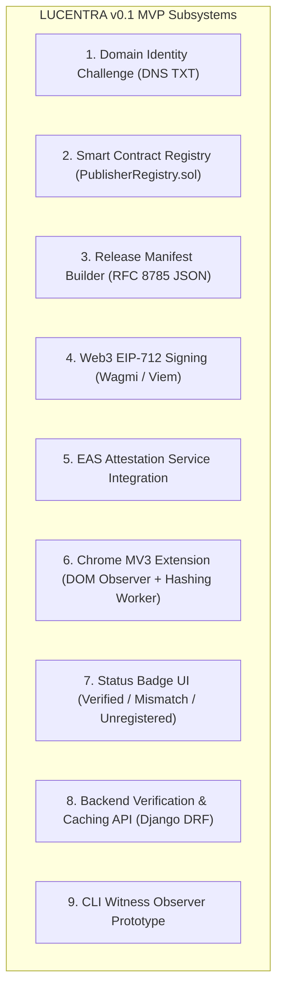

# MVP Features Specification — LUCENTRA

**Document ID:** LUC-PRD-006  
**Version:** 0.1.0  
**Status:** APPROVED  
**Last Updated:** 2026-11-09  

---

## 1. Purpose

This document explicitly defines the Minimum Viable Product (MVP) feature set for LUCENTRA, providing the definitive target for initial development, testing, and deployment.

---

## 2. MVP Definition & Goals

The approved MVP delivers **Publisher Identity Verification + Signed JavaScript Integrity Verification**.

The primary objective of the MVP is to prove that an independent client-side browser extension can reliably intercept website JavaScript resources, hash them, and verify their cryptographic provenance against an on-chain publisher identity without disrupting web usability.

---

## 3. Approved MVP Feature Breakdown

### Detailed Feature Specifications

| Feature ID | Subsystem | Description | Acceptance Test Link |
| :--- | :--- | :--- | :--- |
| **FEAT-001** | Backend / DNS | Generate 256-bit challenge for domain; verify `_lucentra-verification.<domain>` TXT record. | `tests/backend/test_dns.py` |
| **FEAT-002** | Contracts | `PublisherRegistry.sol`: Register domain hash, set authorized signing key, emit event. | `test/PublisherRegistry.t.sol` |
| **FEAT-003** | Frontend | Next.js Publisher Dashboard: Domain registration wizard, Web3 wallet connect. | `apps/dashboard/tests/e2e` |
| **FEAT-004** | Protocol | Manifest compiler: Reads static build directory, produces RFC 8785 canonical manifest JSON. | `packages/core/test/canonical.test.ts` |
| **FEAT-005** | Dashboard | EIP-712 Signing UI: Formats typed data, requests publisher signature via wallet. | `apps/dashboard/tests/signing.test.ts` |
| **FEAT-006** | Contracts / EAS | Submit release attestation referencing EAS schema UID on Sepolia. | `test/EASIntegration.t.sol` |
| **FEAT-007** | Backend | DRF endpoints: `GET /api/v1/domains/{domain}/manifest/active/` returning verified manifest. | `tests/backend/test_api.py` |
| **FEAT-008** | Extension | Manifest V3 Service Worker: intercepts tab navigation, queries manifest, evaluates state. | `apps/extension/tests/worker.test.ts` |
| **FEAT-009** | Extension | Content script & Web Worker: DOM MutationObserver captures `<script>` tags, computes SHA-256. | `apps/extension/tests/hasher.test.ts` |
| **FEAT-010** | Extension | UI Popup & Badge: Displays Green shield for Verified, Red alert for Mismatch. | `apps/extension/tests/ui.test.ts` |
| **FEAT-011** | Witness | CLI witness daemon: Crawls registered domains, verifies assets, logs signed observation. | `tests/witness/test_witness.py` |

---

## 4. MVP Quality Gates

The MVP cannot transition from `IMPLEMENTED` to `VERIFIED` until:
1. Foundry smart contract test suite passes with 100% assertion coverage.
2. Cross-language canonicalization vectors pass identically in TypeScript, Python, and Go.
3. Chrome Extension successfully runs end-to-end on a test web application running locally and deployed to Sepolia testnet.
4. An intentional 1-byte alteration of a JavaScript resource triggers immediate `MISMATCH` state in the extension.

---

## 5. Related Documents

- [docs/01-product-management/OUT_OF_SCOPE.md](OUT_OF_SCOPE.md)
- [docs/01-product-management/ACCEPTANCE_CRITERIA.md](ACCEPTANCE_CRITERIA.md)
- [docs/14-project-management/DEVELOPMENT_ROADMAP.md](../14-project-management/DEVELOPMENT_ROADMAP.md)

---

## 6. References

- [Ethereum Attestation Service](https://docs.attest.org/)
- [EIP-712 Standard](https://eips.ethereum.org/EIPS/eip-712)

