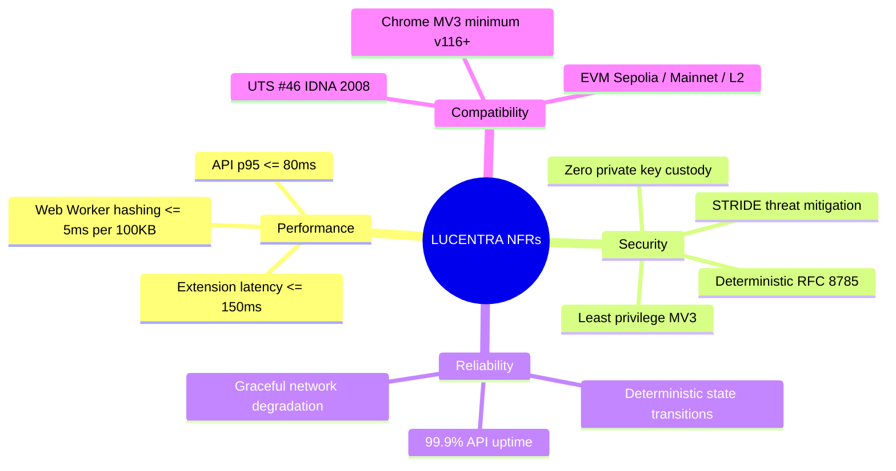

# Non-Functional Requirements — LUCENTRA

**Document ID:** LUC-PRD-005  
**Version:** 0.1.0  
**Status:** APPROVED  
**Last Updated:** 2026-11-09  

---

## 1. Purpose

This document defines the non-functional requirements (NFRs) for LUCENTRA, covering performance, security, reliability, scalability, maintainability, and compatibility.

---

## 2. Requirements Matrix

---

## 3. Detailed Non-Functional Specifications

### 3.1 Performance & Latency (`NFR-PERF`)
- **NFR-PERF-001 (Extension Verification Latency):** The Chrome Extension MUST compute resource hashes, evaluate the verification state machine, and update the badge status within $150\text{ ms}$ (p95) of DOM `DOMContentLoaded` event.
- **NFR-PERF-002 (Web Worker Hashing Throughput):** Resource hashing MUST occur in a dedicated Web Worker and process at least $20\text{ MB/s}$ on standard consumer hardware, never blocking UI thread responsiveness.
- **NFR-PERF-003 (Backend API Response Time):** The Django REST Framework manifest query endpoints MUST respond in $\le 80\text{ ms}$ (p95) under a concurrency load of 500 requests per second.
- **NFR-PERF-004 (Smart Contract Gas Efficiency):** The `registerDomainKey` function in `PublisherRegistry.sol` MUST consume $\le 75,000\text{ gas}$ under standard EVM execution parameters.

### 3.2 Security & Cryptographic Rigor (`NFR-SEC`)
- **NFR-SEC-001 (Zero Server Key Custody):** The LUCENTRA backend infrastructure MUST NEVER hold, process, generate, or store private signing keys for publishers or witnesses.
- **NFR-SEC-002 (Deterministic Canonicalization):** Serialization of JSON release manifests MUST strictly adhere to RFC 8785 (JCS) across all system components (TypeScript, Python, Go) without byte divergence.
- **NFR-SEC-003 (Replay Protection):** All EIP-712 messages MUST include the target `chainId`, `verifyingContract`, `timestamp`, and `nonce` to prevent replay attacks across chains or contracts.
- **NFR-SEC-004 (Extension Sandbox Isolation):** Content scripts MUST NOT execute evaluated code received from untrusted web pages (`eval()` and `new Function()` strictly banned via CSP).

### 3.3 Reliability & Availability (`NFR-REL`)
- **NFR-REL-001 (API Service Availability):** The public backend metadata service MUST maintain a minimum uptime of $99.9\%$ (excluding scheduled maintenance).
- **NFR-REL-002 (Graceful Degradation):** If the centralized LUCENTRA backend API is unreachable, the Chrome Extension MUST fall back to direct EAS on-chain RPC queries or display an `INDETERMINATE` state with clear explanatory diagnostics.
- **NFR-REL-003 (Idempotent Worker Tasks):** All background Celery tasks (DNS resolution, witness ingestion) MUST be strictly idempotent.

### 3.4 Scalability (`NFR-SCA`)
- **NFR-SCA-001 (Horizontal API Scaling):** The backend Django API MUST be stateless, allowing linear horizontal scaling behind a standard reverse proxy (Nginx / Cloudflare).
- **NFR-SCA-002 (Cache Invalidation Strategy):** Manifest lookups MUST be aggressively cached in Redis and client-side `chrome.storage.local` with deterministic cache invalidation upon new release attestations.

### 3.5 Compatibility (`NFR-CMP`)
- **NFR-CMP-001 (Browser Support):** The client extension MUST support all Chromium-based browsers (Chrome, Brave, Edge, Opera) supporting Manifest V3 (Chrome version 116+).
- **NFR-CMP-002 (EVM Compatibility):** Smart contracts MUST be fully compatible with EVM bytecode standards (Solidity 0.8.24, Cancun EVM target) and deployable to Ethereum Sepolia, Ethereum Mainnet, and Arbitrum One.

---

## 4. Dependencies & Security Implications

Failing to meet performance NFRs will degrade user browsing experience, while failing security NFRs directly undermines user trust in verification badges.

---

## 5. Related Documents

- [docs/01-product-management/FUNCTIONAL_REQUIREMENTS.md](FUNCTIONAL_REQUIREMENTS.md)
- [docs/11-security/SECURITY_OVERVIEW.md](../11-security/SECURITY_OVERVIEW.md)

---

## 6. References

- [ISO/IEC 25010: Systems and software engineering — Systems and software Quality Requirements and Evaluation (SQuaRE)](https://iso25000.com/index.php/en/iso-25000-standards/iso-25010)

