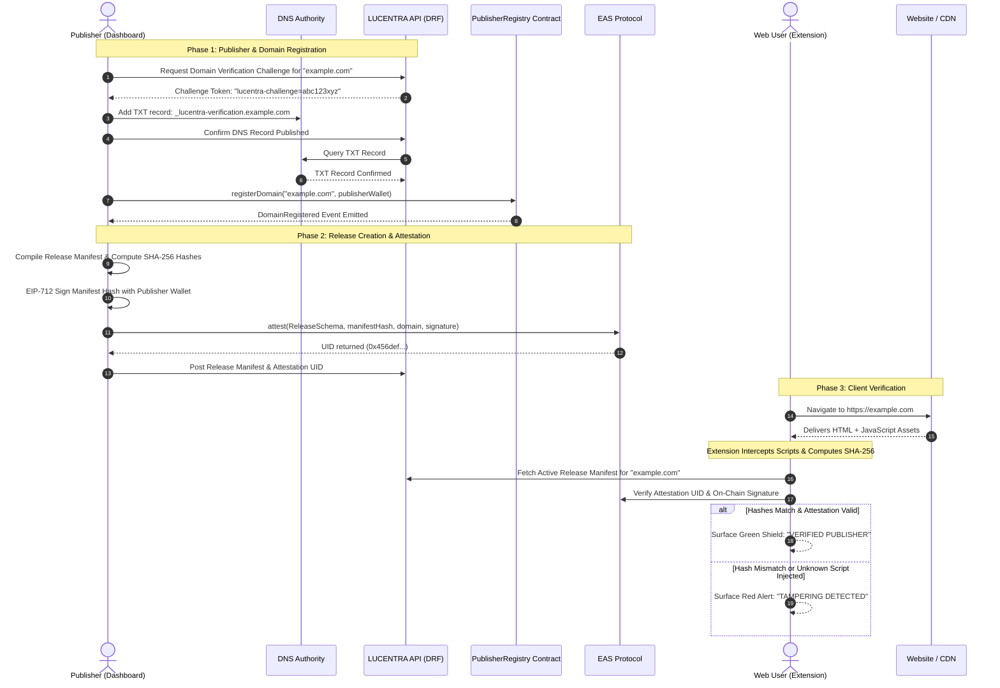

# Product Requirements Document (PRD) — LUCENTRA

**Document ID:** LUC-PRD-001  
**Version:** 0.1.0  
**Status:** APPROVED  
**Last Updated:** 2026-11-09  

---

## 1. Purpose

This document specifies the complete product requirements for the LUCENTRA internet authenticity and verification platform, defining functional capabilities, operational workflows, and system constraints.

---

## 2. Scope

Encompasses the end-to-end user workflows for:
1. Website Publishers registering domains and signing releases.
2. Web End Users verifying website integrity via a Chrome Extension.
3. Independent Witness Operators auditing web deployments.

---

## 3. Product Architecture & Core Workflows

---

## 4. Key Functional Areas

1. **Domain Ownership Verification:** Authoritative DNS TXT verification ensuring the applicant controls the claimed web property.
2. **On-Chain Key Management:** Anchoring authorized publisher wallet addresses to normalized domains on Ethereum.
3. **Deterministic Release Packaging:** RFC 8785 JSON Canonicalization ensuring identical hash generation across distributed environments.
4. **EAS Attestation Integration:** Public, immutable, non-custodial attestation recording.
5. **Real-Time Client Verification:** Chrome Extension (Manifest V3) inspecting DOM scripts, calculating SHA-256 hashes in a Web Worker, and validating against the signed manifest.
6. **Witness Audit Feed:** Decentralized monitoring against targeted split-view tampering.

---

## 5. Dependencies & Security Implications

- Requires secure DNS challenge generation with strong cryptographic entropy.
- System integrity requires that the browser extension strictly validates on-chain records rather than blindly trusting the backend API.

---

## 6. Known Limitations

- Manifest generation currently covers external JavaScript resources; inline scripts must either be hashed as inline blocks or migrated to external scripts.

---

## 7. Related Documents

- [docs/01-product-management/FUNCTIONAL_REQUIREMENTS.md](FUNCTIONAL_REQUIREMENTS.md)
- [docs/01-product-management/NON_FUNCTIONAL_REQUIREMENTS.md](NON_FUNCTIONAL_REQUIREMENTS.md)
- [docs/01-product-management/ACCEPTANCE_CRITERIA.md](ACCEPTANCE_CRITERIA.md)

---

## 8. References

- [Ethereum Attestation Service Documentation](https://docs.attest.org/)
- [EIP-712: Typed structured data hashing and signing](https://eips.ethereum.org/EIPS/eip-712)
- [RFC 8785: JSON Canonicalization Scheme](https://www.rfc-editor.org/rfc/rfc8785.html)
