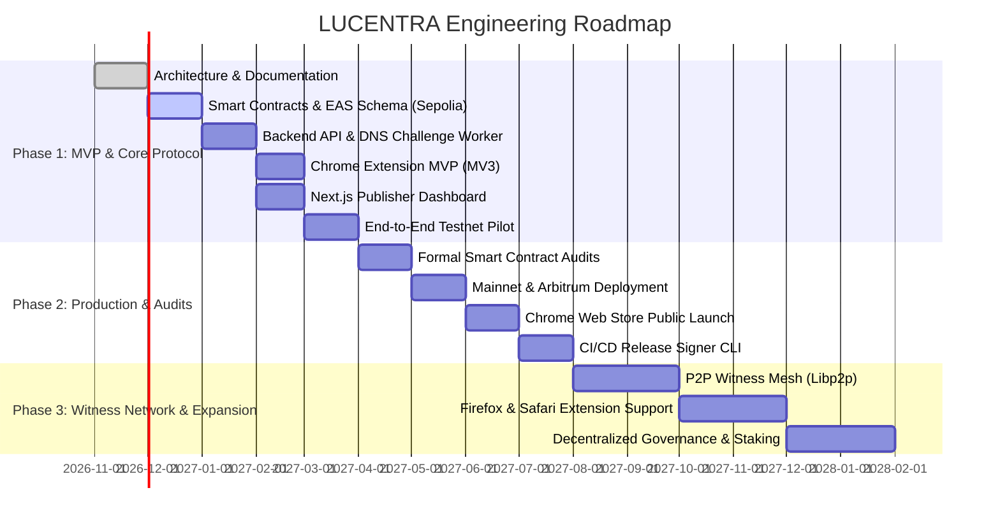

# Product Roadmap — LUCENTRA

**Document ID:** LUC-PRD-008  
**Version:** 0.1.0  
**Status:** APPROVED  
**Last Updated:** 2026-11-09  

---

## 1. Purpose

This document outlines the multi-phase product roadmap for LUCENTRA, defining milestones, release targets, and evolution pathways from MVP to decentralized internet verification infrastructure.

---

## 2. Roadmap Timeline & Phases

---

## 3. Phase Descriptions

### Phase 1: Foundation & Core Verification (v0.1.0 - Current)
- **Goal:** Establish proven end-to-end verification flow on testnet.
- **Key Deliverables:**
  - Complete engineering documentation system.
  - `PublisherRegistry.sol` deployed on Sepolia.
  - EAS schema registration for release manifests.
  - Next.js dashboard with Web3 wallet signing.
  - Chrome Manifest V3 extension with DOM MutationObserver & Web Worker hashing.
  - Basic CLI witness client.

### Phase 2: Hardening, Security Audits & Public Launch (v0.2.0 - v1.0.0)
- **Goal:** Production deployment with institutional security guarantees.
- **Key Deliverables:**
  - Independent smart contract security audits (OpenZeppelin / Trail of Bits).
  - Mainnet and Arbitrum One smart contract deployments.
  - Official Chrome Web Store listing.
  - Automated GitHub Action (`lucentra/release-action`) for automated CI/CD release signing via hardware security modules or ephemeral cloud keys.

### Phase 3: Decentralized Witness Network & Multi-Browser Support (v1.1.0+)
- **Goal:** Unstoppable, censorship-resistant verification layer.
- **Key Deliverables:**
  - Distributed witness network with libp2p gossip channels and consensus scoring.
  - Support for Mozilla Firefox (WebExtensions API) and Apple Safari.
  - Extended verification for CSS, WebAssembly (.wasm), and critical media assets.

---

## 4. Dependencies & Security Implications

Transitions between phases require formal security audits and passing all quality gates defined in `SUCCESS_METRICS.md`.

---

## 5. Related Documents

- [docs/00-project-overview/SUCCESS_METRICS.md](../00-project-overview/SUCCESS_METRICS.md)
- [docs/01-product-management/MVP_FEATURES.md](MVP_FEATURES.md)
- [docs/14-project-management/DEVELOPMENT_ROADMAP.md](../14-project-management/DEVELOPMENT_ROADMAP.md)

---

## 6. References

- [Ethereum Roadmap](https://ethereum.org/en/roadmap/)
- [EAS Documentation](https://docs.attest.org/)

