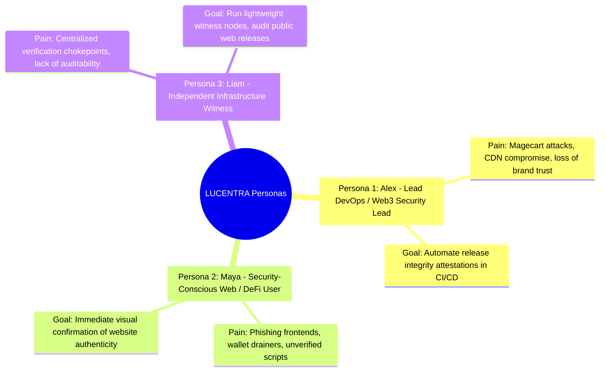

# User Personas — LUCENTRA

**Document ID:** LUC-PRD-002  
**Version:** 0.1.0  
**Status:** APPROVED  
**Last Updated:** 2026-11-09  

---

## 1. Purpose

This document profiles the key user personas interacting with the LUCENTRA ecosystem, outlining their motivations, technical capabilities, pain points, and user journeys.

---

## 2. Personas Overview

---

## 3. Persona Profiles

### Persona 1: Alex — Lead DevOps & Web3 Security Lead
- **Role:** Head of Infrastructure at a major DeFi protocol or e-commerce platform.
- **Technical Competency:** Advanced. Proficient with Docker, GitHub Actions, DNS management, and Web3 wallets.
- **Core Needs:**
  - Fast, reliable domain verification without transferring domain custody.
  - Seamless integration into modern build pipelines (Next.js, Vite, Webpack).
  - Ability to sign releases using institutional multisig (Safe) or hardware wallet (Ledger).
  - Instant revocation capabilities if a signing key is compromised.

### Persona 2: Maya — Security-Conscious Web & DeFi User
- **Role:** Web3 investor, crypto trader, or enterprise browser user.
- **Technical Competency:** Intermediate. Uses browser extensions, understands wallet signing risks.
- **Core Needs:**
  - Zero-friction protection: Extension works in the background without slowing down navigation.
  - Clear visual indicator: Green shield for verified authenticity, bright warning badge for tampered/unauthorized scripts.
  - Granular breakdown: Ability to click the extension badge and inspect which scripts were verified, who the publisher is, and view the EAS attestation on Etherscan/EAS Explorer.

### Persona 3: Liam — Independent Infrastructure Witness
- **Role:** Node runner, open-source enthusiast, security researcher.
- **Technical Competency:** Advanced. Comfortable with terminal tools, Linux servers, and API integration.
- **Core Needs:**
  - Lightweight, deterministic witness client capable of running on minimal VPS specs.
  - Cryptographically robust observation format with non-repudiation.
  - Public visibility into network consensus and divergence detection.

---

## 4. Dependencies & Security Implications

Personas require distinct security profiles: Alex requires strict key separation in CI; Maya requires zero PII collection; Liam requires cryptographic signing of witness logs.

---

## 5. Related Documents

- [docs/01-product-management/USER_STORIES.md](USER_STORIES.md)
- [docs/01-product-management/FUNCTIONAL_REQUIREMENTS.md](FUNCTIONAL_REQUIREMENTS.md)

---

## 6. References

- [Nielsen Norman Group: Persona Design Guidelines](https://www.nngroup.com/articles/persona/)

