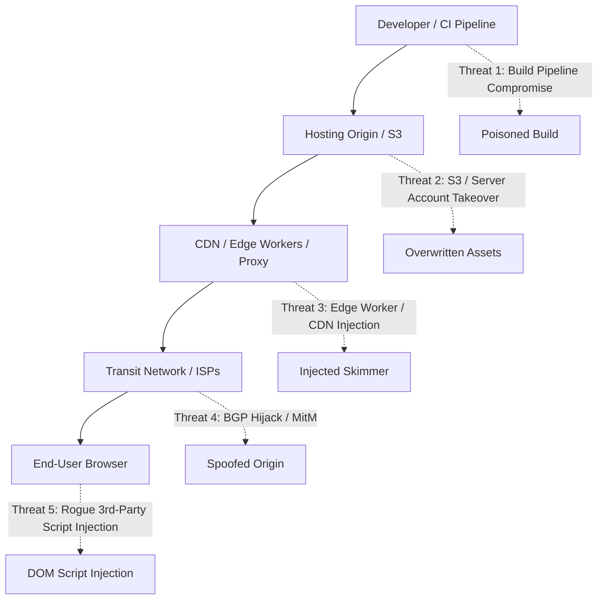

# Problem Research: Web Tampering & Supply Chain Vulnerabilities

**Document ID:** LUC-RES-001  
**Version:** 0.1.0  
**Status:** APPROVED  
**Last Updated:** 2026-11-09  

---

## 1. Purpose

This document provides in-depth technical research into client-side web application tampering, digital skimming (Magecart), CDN compromises, BGP hijacking, and software supply chain poisoning.

---

## 2. Historical Attack Case Studies

### 2.1 British Airways Magecart Incident (2018)
- **Vector:** Adversaries gained access to British Airways' internal build/deployment infrastructure and modified a single 22-line JavaScript script (`modernizr-2.6.2.min.js`).
- **Impact:** Over 380,000 payment card transactions intercepted; resulted in a £20 million GDPR fine.
- **Why HTTPS/SRI Failed:** The compromised script was hosted on BA's own origin server. HTTPS delivered the file securely to the client. The root HTML had no SRI hash for this first-party resource.

### 2.2 Ledger Connect Kit Supply Chain Compromise (December 2023)
- **Vector:** Phishing of a former Ledger employee compromised their npm developer account. The attacker pushed rogue versions (1.1.5, 1.1.6, 1.1.7) of `@ledgerhq/connect-kit` containing a crypto wallet drainer.
- **Impact:** Because many dApps (SushiSwap, Zapper, Revoke.cash) pulled this dependency via unpinned CDN URLs (`cdn.jsdelivr.net`), millions of users were instantly exposed to malicious code. Over \$600,000 was stolen within two hours.
- **Why HTTPS Failed:** The CDN served the rogue script over valid HTTPS. Users had zero cryptographic proof whether Ledger had authorized that specific release.

### 2.3 BadgerDAO Cloudflare Injection (December 2021)
- **Vector:** Attackers obtained compromised Cloudflare API credentials and injected unauthorized JavaScript into BadgerDAO's web traffic via Cloudflare Workers.
- **Impact:** The injected script intercepted Web3 wallet approvals, draining over \$120 million in assets.
- **Architectural Lesson:** Any intermediate infrastructure (proxy, edge worker, CDN) can alter code unless the client validates the code independently.

---

## 3. Threat Taxonomy in Web Resource Delivery

---

## 4. Key Findings

1. **The Browser Blindspot:** Once code enters the browser execution engine, the browser cannot differentiate between an authorized script and an attacker-injected script unless an external, tamper-proof integrity manifest is available.
2. **First-Party Script Vulnerability:** Over 92% of client-side breaches target scripts hosted on first-party domains or trusted CDNs where Subresource Integrity (SRI) is absent.
3. **Decentralized Verification Necessity:** Relying on the web server to tell the browser what is authentic is an architectural circular dependency. Verification must be anchored externally (on Ethereum / EAS).

---

## 5. Related Documents

- [docs/00-project-overview/PROBLEM_STATEMENT.md](../00-project-overview/PROBLEM_STATEMENT.md)
- [docs/02-research-and-analysis/EXISTING_SOLUTIONS.md](EXISTING_SOLUTIONS.md)
- [docs/02-research-and-analysis/TECHNICAL_GAP_ANALYSIS.md](TECHNICAL_GAP_ANALYSIS.md)

---

## 6. References

- [RiskIQ Magecart Research Report](https://www.riskiq.com/)
- [UK ICO British Airways Penalty Notice](https://ico.org.uk/)
- [Ledger Connect Kit Post-Mortem](https://www.ledger.com/)
