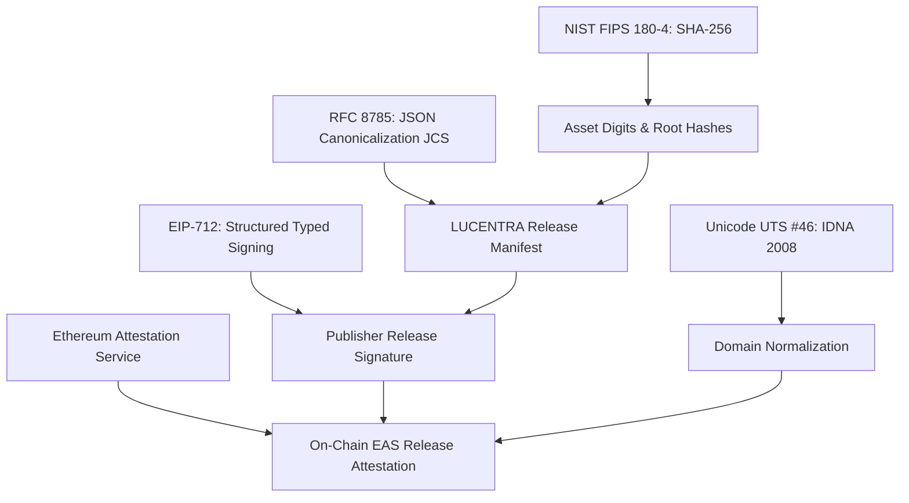

# Standards and RFC Research — LUCENTRA

**Document ID:** LUC-RES-004  
**Version:** 0.1.0  
**Status:** APPROVED  
**Last Updated:** 2026-11-09  

---

## 1. Purpose

This document documents the technical standards, IETF RFCs, and Ethereum Improvement Proposals (EIPs) upon which LUCENTRA is constructed.

---

## 2. Normative Standards Breakdown

### 2.1 RFC 8785: JSON Canonicalization Scheme (JCS)
- **Standard:** IETF RFC 8785.
- **Role:** Ensures deterministic serialization of JSON manifest data prior to cryptographic hashing.
- **Critical Rules:**
  1. Object keys must be sorted lexicographically by Unicode code point order.
  2. Whitespace outside string literals must be completely eliminated.
  3. Numbers must be formatted without trailing zeroes or exponential notation where standard representation applies.
  4. Strings must use standard escape sequences (`\"`, `\\`, etc.).

### 2.2 EIP-712: Typed Structured Data Hashing and Signing
- **Standard:** Ethereum Improvement Proposal 712.
- **Role:** Provides human-readable, domain-bound cryptographic signing of release manifests.
- **Components:**
  - `EIP712Domain`: `name`, `version`, `chainId`, `verifyingContract`.
  - Type Hash: `keccak256("ReleaseManifest(string domain,string version,bytes32 manifestHash,uint64 timestamp,uint64 expiresAt)")`.

### 2.3 NIST FIPS 180-4: Secure Hash Standard (SHA-256)
- **Standard:** National Institute of Standards and Technology FIPS PUB 180-4.
- **Role:** Cryptographic digest generation for individual JavaScript resources and the root manifest. Provides 128-bit collision resistance and 256-bit pre-image resistance.

### 2.4 Unicode Technical Standard #46 (UTS #46) / IDNA 2008
- **Standard:** Unicode IDNA Compatibility Processing.
- **Role:** Prevents homograph and spoofing attacks by mapping internationalized domain names (IDNs) to ASCII punycode before hashing or on-chain registration.

---

## 3. Related Documents

- [docs/04-protocol/CANONICALIZATION.md](../04-protocol/CANONICALIZATION.md)
- [docs/05-cryptography/EIP712_SIGNING.md](../05-cryptography/EIP712_SIGNING.md)

---

## 4. References

- [RFC 8785: JSON Canonicalization Scheme](https://www.rfc-editor.org/rfc/rfc8785.html)
- [EIP-712 Standard](https://eips.ethereum.org/EIPS/eip-712)
- [NIST FIPS 180-4](https://csrc.nist.gov/pubs/fips/180-4/upd1/final)
- [Unicode UTS #46](https://unicode.org/reports/tr46/)

