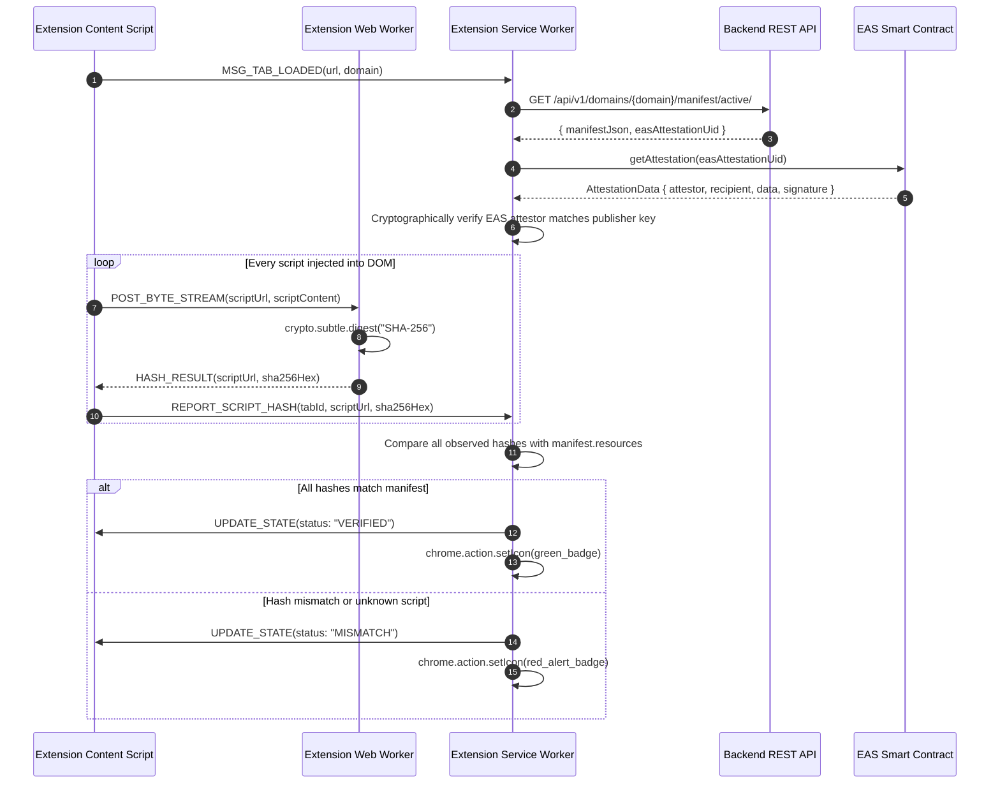

# Component Interactions — LUCENTRA

**Document ID:** LUC-ARC-007  
**Version:** 0.1.0  
**Status:** APPROVED  
**Last Updated:** 2026-11-09  

---

## 1. Purpose

This document details the interface contracts, message formats, and inter-process communication protocols linking the various subsystems of LUCENTRA.

---

## 2. Component Interaction Matrix



---

## 3. Communication Protocols Breakdown

### 3.1 Extension Internal IPC (Content Script $\leftrightarrow$ Service Worker)
- **Transport:** `chrome.runtime.sendMessage` and `chrome.tabs.sendMessage`.
- **Payload Schema:**
```typescript
export interface ExtensionMessage {
  type: "LUCENTRA_SCRIPT_OBSERVED" | "LUCENTRA_STATUS_UPDATE" | "LUCENTRA_REQUEST_MANIFEST";
  payload: {
    tabId: number;
    url: string;
    domain: string;
    sha256?: string;
    status?: "VERIFIED" | "MISMATCH" | "UNREGISTERED" | "UNATTESTED";
  };
}
```

### 3.2 Extension $\leftrightarrow$ Backend REST API
- **Transport:** HTTPS JSON REST.
- **Header:** `Accept: application/json`, `User-Agent: LUCENTRA-Extension/0.1.0`.
- **Primary Endpoint:** `GET /api/v1/domains/{domain}/manifest/active/`.

### 3.3 Dashboard $\leftrightarrow$ Ethereum RPC
- **Transport:** JSON-RPC over HTTPS / WSS via Viem & Wagmi.
- **Functions:**
  - `PublisherRegistry.registerDomain(string domain, address owner, bytes signature)`
  - `IEAS.attest(AttestationRequest request)`

---

## 4. Dependencies & Security Implications

Message passing inside the browser extension must enforce origin validation to prevent malicious host scripts from broadcasting fake verification messages to the background worker.

---

## 5. Related Documents

- [docs/03-architecture/LOW_LEVEL_DESIGN.md](LOW_LEVEL_DESIGN.md)
- [docs/09-browser-extension/SERVICE_WORKER.md](../09-browser-extension/SERVICE_WORKER.md)

---

## 6. References

- [Chrome Extension Message Passing API](https://developer.chrome.com/docs/extensions/mv3/messaging/)
