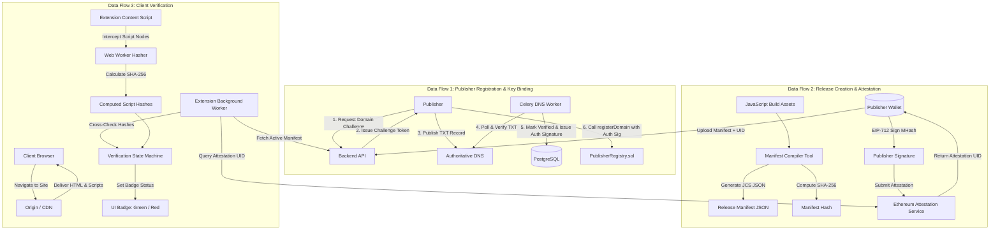

# Data Flow Architecture — LUCENTRA

**Document ID:** LUC-ARC-005  
**Version:** 0.1.0  
**Status:** APPROVED  
**Last Updated:** 2026-11-09  

---

## 1. Purpose

This document maps all end-to-end data flows within LUCENTRA, tracing cryptographic tokens, release manifests, asset byte streams, and verification signals through the system.

---

## 2. Global Data Flow Pipelines

---

## 3. Data Flow Descriptions

### 3.1 Domain Ownership Challenge Pipeline
1. Publisher submits `domain` to `POST /api/v1/domains/challenge/`.
2. Backend generates a 32-byte cryptographic nonce, stores it with an expiry of 24 hours, and returns `_lucentra-verification.<domain>` configuration instructions.
3. Celery task periodically queries nameservers using DNS-over-HTTPS or direct UDP query.
4. Upon confirmation, backend signs an ECDSA authorization ticket that permits the publisher's wallet address to invoke `registerDomain` on `PublisherRegistry.sol`.

### 3.2 Manifest Creation & Attestation Pipeline
1. Build script scans production assets in the distribution folder (`dist/` or `out/`).
2. Calculates SHA-256 digest of each `.js` file.
3. Formats the JSON object conforming to `LUCENTRA-Manifest-v0.1`.
4. Serializes using RFC 8785 JSON Canonicalization Scheme.
5. Hashes the canonical JSON string with SHA-256 to produce `manifestHash`.
6. Requests EIP-712 signature from the publisher's authorized key.
7. Submits `attest()` transaction to the EAS smart contract on Ethereum / Arbitrum.
8. Posts canonical manifest and resulting EAS UID to the LUCENTRA backend API.

### 3.3 Client Verification Pipeline
1. Content script detects `<script>` insertion via `MutationObserver`.
2. Dispatches asset URL to Web Worker; Web Worker fetches byte buffer and calls `crypto.subtle.digest("SHA-256", buffer)`.
3. Extension background service worker checks cache for the active domain manifest and EAS UID.
4. Compares all computed asset hashes against the manifest.
5. If all scripts match and attestation is valid: outputs `VERIFIED`.
6. If any script fails to match or an unknown script is executed: outputs `MISMATCH`.

---

## 4. Dependencies & Security Implications

Data flows cross multiple trust boundaries (untrusted client browser $\rightarrow$ untrusted web host $\rightarrow$ untrusted backend $\rightarrow$ trusted Ethereum state). Strict cryptographic cross-checks ensure that data integrity is maintained at every transition.

---

## 5. Related Documents

- [docs/03-architecture/TRUST_BOUNDARIES.md](TRUST_BOUNDARIES.md)
- [docs/04-protocol/PROTOCOL_SPECIFICATION_V0.1.md](../04-protocol/PROTOCOL_SPECIFICATION_V0.1.md)

---

## 6. References

- [RFC 8785: JSON Canonicalization Scheme](https://www.rfc-editor.org/rfc/rfc8785.html)
- [W3C Web Cryptography API](https://www.w3.org/TR/WebCryptoAPI/)
