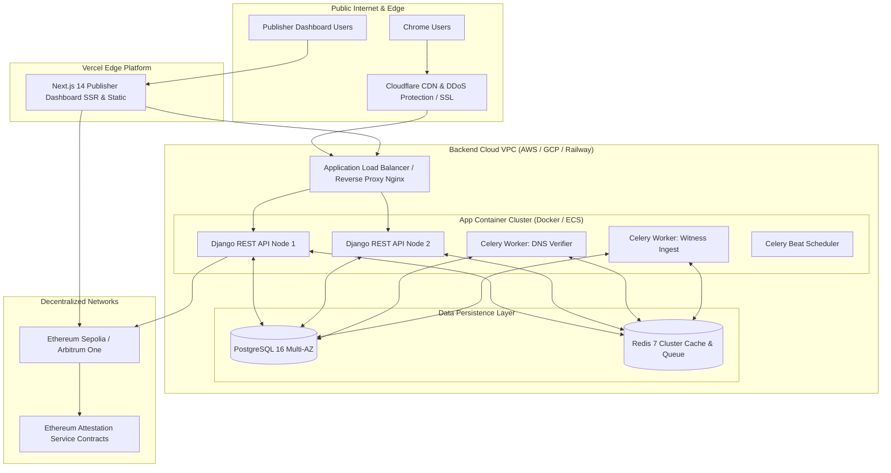

# Deployment Architecture — LUCENTRA

**Document ID:** LUC-ARC-008  
**Version:** 0.1.0  
**Status:** APPROVED  
**Last Updated:** 2026-11-09  

---

## 1. Purpose

This document outlines the deployment topology, infrastructure provisioning, network security boundaries, and hosting environments across development, staging, and production.

---

## 2. Infrastructure Deployment Topology

---

## 3. Environment Environments & Networks

| Environment | Frontend Hosting | Backend Hosting | Database & Cache | Blockchain Network | Target Purpose |
| :--- | :--- | :--- | :--- | :--- | :--- |
| **Local Dev** | `localhost:3000` (Next.js) | `localhost:8000` (Django runserver) | Docker (PostgreSQL 16 + Redis 7) | Foundry Anvil (`localhost:8545`) | Unit & integration development |
| **Staging** | Vercel Preview | AWS ECS / Railway Staging | Managed Postgres + Redis | Ethereum Sepolia Testnet | End-to-end integration & QA |
| **Production** | Vercel Production | AWS ECS Multi-AZ / Fargate | AWS RDS Aurora Postgres + ElastiCache | Ethereum Mainnet / Arbitrum One | Production live traffic |

---

## 4. Dependencies & Security Implications

All internal database and Redis connections must be confined within private VPC subnets with SSL encryption in transit (`sslmode=require`). No database port is exposed to the public internet.

---

## 5. Related Documents

- [docs/13-devops/DEVELOPMENT_ENVIRONMENT.md](../13-devops/DEVELOPMENT_ENVIRONMENT.md)
- [docs/13-devops/BUILD_AND_DEPLOYMENT.md](../13-devops/BUILD_AND_DEPLOYMENT.md)

---

## 6. References

- [Next.js Deployment Documentation](https://nextjs.org/docs/deployment)
- [AWS Well-Architected Framework](https://aws.amazon.com/architecture/well-architected/)

