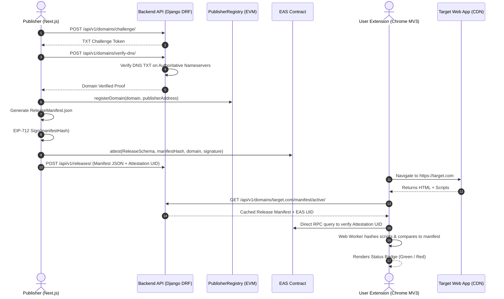

# High-Level Design (HLD) — LUCENTRA

**Document ID:** LUC-ARC-002  
**Version:** 0.1.0  
**Status:** APPROVED  
**Last Updated:** 2026-11-09  

---

## 1. Purpose

This High-Level Design (HLD) document outlines the system-level component relationships, communication protocols, and architectural models governing the LUCENTRA platform.

---

## 2. System Level Communication Protocols

---

## 3. Subsystem Architectural Roles

### 3.1 Next.js Publisher Dashboard (`apps/dashboard`)
- Implements Wagmi / Viem Web3 wallet connectors.
- Provides publisher registration wizard, domain challenge tracking, and release management.
- Runs RFC 8785 canonical manifest compilation directly in browser / Node runtime.
- Executes client-side EIP-712 signatures.

### 3.2 Backend Service (`services/backend`)
- Built on Python 3.11+ and Django REST Framework.
- Utilizes Celery for non-blocking asynchronous DNS TXT lookups using authoritative nameservers.
- Provides REST endpoints for manifest retrieval, domain status lookups, and witness observation submissions.
- Backed by PostgreSQL for relational state and Redis for caching and Celery message broker.

### 3.3 Ethereum Smart Contracts (`contracts/`)
- Written in Solidity 0.8.24, tested and built with Foundry.
- `PublisherRegistry.sol` provides non-custodial domain-to-address bindings, key rotation, and revocation primitives.
- Integrates with Ethereum Attestation Service (EAS) schemas for standardized release attestations.

### 3.4 Chrome Browser Extension (`apps/extension`)
- Conforms strictly to Chrome Manifest V3.
- Utilizes content scripts with DOM MutationObserver for script tag interception.
- Utilizes Web Workers for non-blocking SHA-256 byte stream hashing.
- Features a background service worker managing state in `chrome.storage.local`.

---

## 4. Dependencies & Security Implications

- The architecture decouples the caching layer from the cryptographic root of trust. If the backend fails or returns falsified data, the client's direct on-chain verification detects the signature invalidity immediately.

---

## 5. Related Documents

- [docs/03-architecture/SYSTEM_ARCHITECTURE.md](SYSTEM_ARCHITECTURE.md)
- [docs/03-architecture/LOW_LEVEL_DESIGN.md](LOW_LEVEL_DESIGN.md)
- [docs/03-architecture/DATA_FLOW.md](DATA_FLOW.md)

---

## 6. References

- [Next.js Documentation](https://nextjs.org/docs)
- [Viem Documentation](https://viem.sh/)
- [Django REST Framework](https://www.django-rest-framework.org/)
