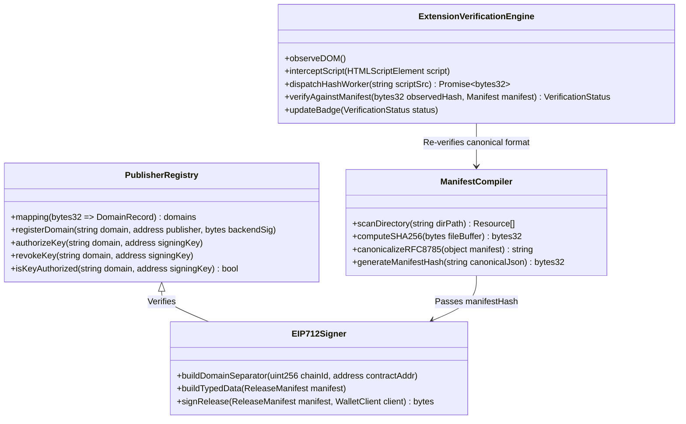

# Low-Level Design (LLD) — LUCENTRA

**Document ID:** LUC-ARC-003  
**Version:** 0.1.0  
**Status:** APPROVED  
**Last Updated:** 2026-11-09  

---

## 1. Purpose

This Low-Level Design (LLD) document specifies the concrete data structures, class designs, interface signatures, and module breakdowns for LUCENTRA.

---

## 2. Core Module Breakdown



---

## 3. Concrete Data Structures

### 3.1 Smart Contract: `DomainRecord` Struct (`contracts/src/PublisherRegistry.sol`)
```solidity
struct DomainRecord {
    string domain;              // Normalized domain string (e.g. "app.uniswap.org")
    address owner;              // Publisher primary admin address
    uint64 registeredAt;        // Unix timestamp of registration
    bool isRevoked;             // Global revocation flag
    mapping(address => KeyStatus) authorizedKeys; // Authorized signing keys
}

enum KeyStatus {
    UNAUTHORIZED,
    ACTIVE,
    REVOKED
}
```

### 3.2 Protocol: Release Manifest Type (`packages/core/src/types.ts`)
```typescript
export interface ReleaseResource {
  path: string;           // e.g. "/static/js/main.b8f41a.js"
  size: number;           // Byte length
  sha256: string;         // Lowercase hex prefixed with "sha256:<64-chars>"
  type: "script" | "module" | "worker";
}

export interface ReleaseManifest {
  schemaVersion: "LUCENTRA-Manifest-v0.1";
  domain: string;         // e.g. "example.com"
  version: string;        // Semantic version or git commit hash
  createdAt: number;      // Unix timestamp in seconds
  expiresAt: number;      // Unix timestamp in seconds
  resources: ReleaseResource[];
}
```

### 3.3 Backend: Django Model Architecture (`services/backend/apps/registry/models.py`)
```python
class Domain(models.Model):
    normalized_name = models.CharField(max_length=255, unique=True, db_index=True)
    domain_hash = models.CharField(max_length=66, unique=True, db_index=True) # 0x + 64 hex
    owner_address = models.CharField(max_length=42, db_index=True)
    is_dns_verified = models.BooleanField(default=False)
    verification_token = models.CharField(max_length=64, blank=True)
    challenge_created_at = models.DateTimeField(null=True, blank=True)
    registered_on_chain = models.BooleanField(default=False)
    created_at = models.DateTimeField(auto_now_add=True)

class Release(models.Model):
    domain = models.ForeignKey(Domain, on_delete=models.CASCADE, related_name="releases")
    version = models.CharField(max_length=64)
    manifest_hash = models.CharField(max_length=66, db_index=True)
    canonical_manifest_json = models.TextField()
    eas_attestation_uid = models.CharField(max_length=66, unique=True, db_index=True)
    signing_address = models.CharField(max_length=42)
    is_active = models.BooleanField(default=True)
    created_at = models.DateTimeField(auto_now_add=True)
```

---

## 4. Dependencies & Security Implications

- Domain hash computation must strictly match `keccak256(bytes(normalizedDomain))` in both Solidity and off-chain libraries.
- Database models must enforce case-insensitive uniqueness on `normalized_name`.

---

## 5. Related Documents

- [docs/03-architecture/HIGH_LEVEL_DESIGN.md](HIGH_LEVEL_DESIGN.md)
- [docs/04-protocol/MANIFEST_SCHEMA.md](../04-protocol/MANIFEST_SCHEMA.md)
- [docs/06-blockchain/SMART_CONTRACT_DESIGN.md](../06-blockchain/SMART_CONTRACT_DESIGN.md)

---

## 6. References

- [OpenZeppelin Contracts v5.x](https://docs.openzeppelin.com/contracts/5.x/)
- [RFC 8785: JSON Canonicalization Scheme](https://www.rfc-editor.org/rfc/rfc8785.html)
