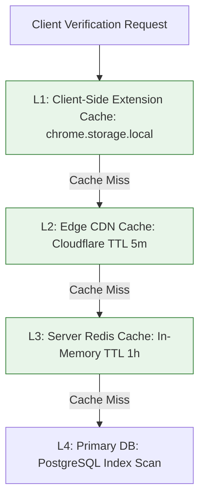

# Scalability Strategy — LUCENTRA

**Document ID:** LUC-ARC-009  
**Version:** 0.1.0  
**Status:** APPROVED  
**Last Updated:** 2026-11-09  

---

## 1. Purpose

This document details the architectural scaling strategy for LUCENTRA to handle high request volumes across millions of client extension page-load verification requests and background audit cycles.

---

## 2. Horizontal Scaling & Caching Layers

### 2.1 Multi-Tier Caching Architecture
1. **L1: Browser Local Storage (`chrome.storage.local`):** When a user navigates between pages on the same domain, the manifest and verified attestation are retrieved from extension local storage in $< 1\text{ ms}$.
2. **L2: Edge CDN Caching (Cloudflare):** Manifest GET endpoints (`/api/v1/domains/{domain}/manifest/active/`) are cached at the edge with HTTP cache headers (`Cache-Control: public, max-age=300, stale-while-revalidate=60`).
3. **L3: Server In-Memory Cache (Redis):** Frequently requested domain records and manifests are indexed in Redis, avoiding PostgreSQL queries.
4. **L4: Relational Database (PostgreSQL):** Manifests are indexed on `normalized_name` and `manifest_hash` with B-tree indices.

### 2.2 Asynchronous Worker Scaling
- **Celery Worker Autoscaling:** Worker processes handling DNS challenge verification and witness observation ingestion scale independently based on queue depth in Redis.
- **Batch Processing:** Witness observation ingestion uses database bulk insertion (`bulk_create`) to absorb observation spikes from thousands of concurrent witness daemons.

---

## 3. Blockchain Scalability & Gas Strategy
- **Layer 2 Rollup Migration:** While initial testnet deployment targets Ethereum Sepolia, production deployment incorporates Arbitrum One or Optimism, reducing key registration and attestation transaction fees by $> 95\%$.
- **Off-Chain Manifest Anchoring:** By only committing the 32-byte `manifestHash` on-chain rather than full JSON documents, smart contract execution requires minimal gas regardless of manifest size.

---

## 4. Dependencies & Security Implications

Cache invalidation must be deterministic: whenever a publisher publishes a new release attestation, the backend API purges Redis and edge CDN caches for that domain immediately.

---

## 5. Related Documents

- [docs/03-architecture/SYSTEM_ARCHITECTURE.md](SYSTEM_ARCHITECTURE.md)
- [docs/06-blockchain/GAS_OPTIMIZATION.md](../06-blockchain/GAS_OPTIMIZATION.md)

---

## 6. References

- [High Performance Browser Networking (Ilya Grigorik)](https://hpbn.co/)

