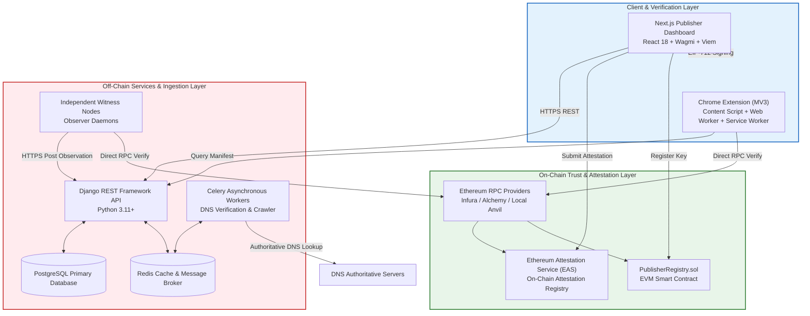

# System Architecture — LUCENTRA

**Document ID:** LUC-ARC-001  
**Version:** 0.1.0  
**Status:** APPROVED  
**Last Updated:** 2026-11-09  

---

## 1. Purpose

This document specifies the top-level system architecture of LUCENTRA, defining the architectural topology, component boundaries, communication protocols, and subsystem responsibilities.

---

## 2. Architectural Philosophy: Hybrid Web2/Web3

LUCENTRA implements a deliberate **hybrid Web2/Web3 architecture**:
- **On-Chain (Web3 / Ethereum):** Serves strictly as the immutable, decentralized anchor of trust for publisher identities (`PublisherRegistry.sol`), signing key lifecycles, and cryptographic release attestations (via Ethereum Attestation Service).
- **Off-Chain (Web2 / Django REST Framework):** Handles high-throughput, low-latency metadata serving, domain DNS TXT challenge coordination, manifest indexing, and witness telemetry aggregation.
- **Client-Side (Browser / Chrome MV3):** Operates directly in the end-user's browser, autonomously intercepting network resources, computing cryptographic digests, and evaluating verification states against on-chain attestations.

---

## 3. Core Architectural Subsystems

### 3.1 On-Chain Layer (Ethereum & EAS)
- **Role:** Immutable root of truth.
- **Key Contracts:**
  - `PublisherRegistry.sol`: Maps `keccak256(domain)` to registered publisher address and authorized signing key addresses.
  - `IEAS.sol`: Ethereum Attestation Service core contract validating release attestations matching official schema UIDs.
- **Non-Custodial Guarantee:** No server holds signing keys. Keys are managed by publisher wallets (hardware wallets, Safe multisig, or CI/CD signing keys).

### 3.2 Off-Chain Ingestion & Acceleration Layer (Django / PostgreSQL / Celery)
- **Role:** High-speed metadata cache and background coordinator.
- **Responsibilities:**
  - Coordinates DNS TXT verification challenges.
  - Ingests and stores canonical JSON release manifests.
  - Serves cached manifests to client extensions in $< 80\text{ ms}$.
  - Ingests and aggregates independent witness observations.
- **Zero-Trust Assumption:** The client extension treats the backend as an untrusted cache. Every manifest received is independently verified against the publisher's on-chain EAS attestation.

### 3.3 Browser Verification Engine (Chrome MV3 Extension)
- **Role:** End-user cryptographic protection.
- **Key Subcomponents:**
  - **Content Script:** Injected at `document_start` on active web pages; attaches a `MutationObserver` to intercept `<script>` tags before execution.
  - **Web Worker:** Offloads CPU-intensive SHA-256 byte hashing off the main browser thread.
  - **Background Service Worker:** Queries active release manifests, checks EAS attestations via Ethereum RPC or backend cache, and controls the toolbar badge state.

### 3.4 Independent Witness Network
- **Role:** Multi-party distributed audit layer.
- **Mechanism:** Decentralized worker nodes independently fetch web assets, compute hashes, compare against EAS attestations, and submit signed cryptographic observations. Protects against targeted split-view tampering.

---

## 4. Dependencies & Security Implications

- **Decoupled Security:** A total compromise of the Django backend database does **not** allow an attacker to forge release attestations, because the Chrome extension verifies the cryptographic EIP-712 signature against the on-chain registry.
- **EVM RPC Dependency:** Extensions cache verified on-chain states locally to maintain performance even during RPC latency spikes.

---

## 5. Known Limitations

- High gas price environments on Ethereum L1 could make key registration expensive; deployment strategy incorporates Layer 2 rollups (Arbitrum One) for cost reduction.

---

## 6. Related Documents

- [docs/03-architecture/HIGH_LEVEL_DESIGN.md](HIGH_LEVEL_DESIGN.md)
- [docs/03-architecture/LOW_LEVEL_DESIGN.md](LOW_LEVEL_DESIGN.md)
- [docs/03-architecture/TRUST_BOUNDARIES.md](TRUST_BOUNDARIES.md)
- [docs/03-architecture/decisions/ADR-001.md](decisions/ADR-001.md)

---

## 7. References

- [Ethereum Architecture Guide](https://ethereum.org/en/developers/docs/architecture/)
- [EAS Documentation](https://docs.attest.org/)
