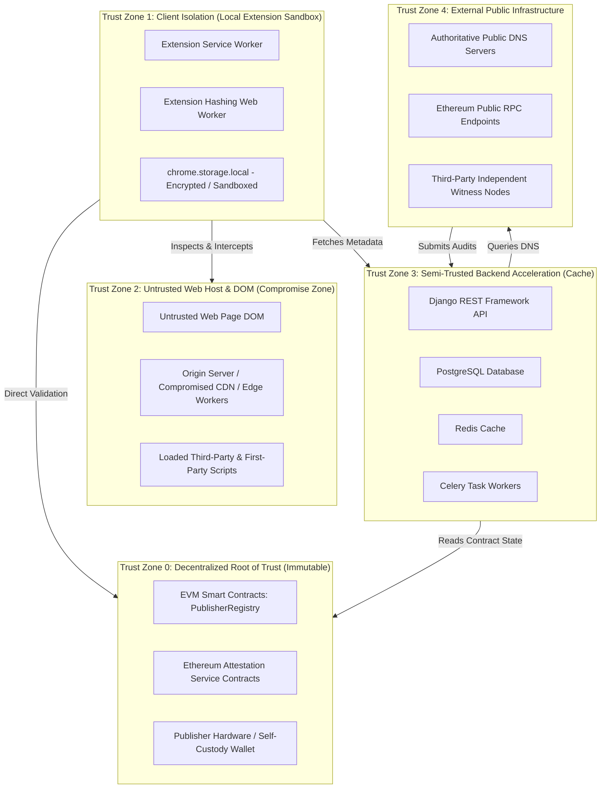

# Trust Boundaries & Threat Zones — LUCENTRA

**Document ID:** LUC-ARC-006  
**Version:** 0.1.0  
**Status:** APPROVED  
**Last Updated:** 2026-11-09  

---

## 1. Purpose

This document formally delineates the trust zones, trust boundaries, and assumptions of trustworthiness across the LUCENTRA architecture.

---

## 2. Trust Zones Taxonomy

---

## 3. Trust Boundary Transitions & Verification Rules

### Boundary 1: Untrusted Web Page DOM $\rightarrow$ Extension Content Script
- **Threat Vector:** Malicious scripts in the web page attempt to spoof extension message passing, tamper with JavaScript prototypes (`Object.prototype`), or inject fake verification events.
- **Enforcement Rule:** Content scripts operate in an **Isolated World**. Web page scripts cannot access extension JavaScript variables or prototype scopes. Extension message passing validates `sender.id` strictly against `chrome.runtime.id`.

### Boundary 2: Semi-Trusted Backend API $\rightarrow$ Extension Verification Engine
- **Threat Vector:** The Django API is compromised or MITM'd, serving a falsified release manifest containing an attacker's script hashes.
- **Enforcement Rule:** The extension **never** accepts a manifest simply because the backend API served it. The extension independently computes `manifestHash = SHA256(RFC8785(manifest))` and verifies that this hash matches the on-chain EAS attestation signed by the publisher's authorized key.

### Boundary 3: DNS Record $\rightarrow$ Backend Verification Worker
- **Threat Vector:** DNS cache poisoning or spoofed UDP DNS responses.
- **Enforcement Rule:** The verification worker queries authoritative nameservers directly using DNSSEC validation where supported, requiring multiple consecutive confirmation queries before authorizing domain registration.

### Boundary 4: Publisher Dashboard $\rightarrow$ Ethereum Network
- **Threat Vector:** Phishing frontends or compromised RPC endpoints attempt to redirect contract registrations.
- **Enforcement Rule:** Contracts use EIP-712 structured data signing with strict chain ID and contract address validation. Nonces prevent replay attacks.

---

## 4. Dependencies & Security Implications

Explicit trust boundaries ensure that even in the event of a catastrophic server-side breach of LUCENTRA's infrastructure, no end-user running the Chrome extension can be coerced into accepting a tampered website release.

---

## 5. Related Documents

- [docs/03-architecture/SYSTEM_ARCHITECTURE.md](SYSTEM_ARCHITECTURE.md)
- [docs/11-security/THREAT_MODEL.md](../11-security/THREAT_MODEL.md)
- [docs/11-security/ATTACK_SURFACE_ANALYSIS.md](../11-security/ATTACK_SURFACE_ANALYSIS.md)

---

## 6. References

- [Chrome Extension Content Script Execution Environments](https://developer.chrome.com/docs/extensions/mv3/content_scripts/#isolated_world)
- [NIST SP 800-207: Zero Trust Architecture](https://csrc.nist.gov/publications/detail/sp/800-207/final)

