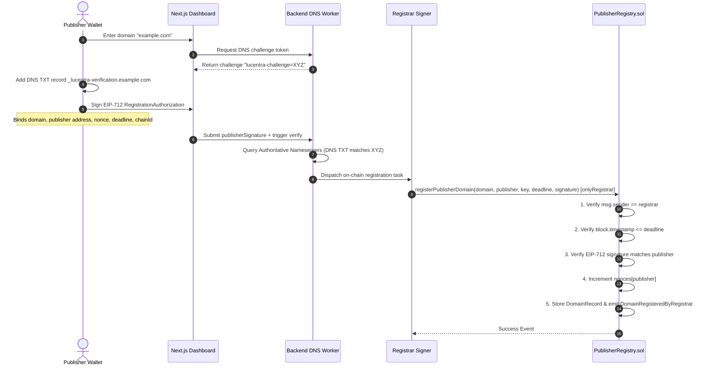

# Architecture Decision Record (ADR) — Dual-Authorization Domain Registration

**Document ID:** ADR-011  
**Title:** Dual-Authorization Domain Registration via EIP-712 Intent Binding and Registrar DNS Validation  
**Status:** PROPOSED  
**Deciders:** Chief Technology Architect, Security Architect, Protocol Engineer, Mustafa (Stakeholder)  
**Date:** 2026-11-10  

---

## 1. Context and Problem Statement

In the current `PublisherRegistry.sol` (v0.2.0), initial domain registration is restricted to an authorized backend `Registrar` role (`onlyRegistrar`). The registrar verifies domain ownership off-chain via DNS TXT records, then invokes `registerPublisherDomain(domain, owner, initialSigningKey)`.

While this model successfully prevents public front-running in the EVM mempool, it places unilateral trust in the registrar key:
1. **Unilateral Registrar Authority:** A compromised, buggy, or rogue registrar could register a verified domain to an unauthorized `owner` address without the publisher's consent or cryptographic proof.
2. **Coupled Identity Establishment:** The publisher wallet never signs a cryptographic intent specifically authorizing its address to be bound to `domain`.
3. **Mempool & Signature Substitution Risks:** If signatures are relayed publicly without strict domain separation, chain binding, nonces, and gas abstraction, adversaries could replay authorization tokens across chains or testnets.

To eliminate single points of failure, domain DNS ownership and publisher wallet authorization must be **independently established and cryptographically verified on-chain**.

---

## 2. Decision Drivers

- **Zero Unilateral Registrar Authority:** A compromised registrar key must never have the power to bind a domain to an arbitrary address without the genuine publisher's signature.
- **Independent Proof of Intent:** The publisher wallet must cryptographically sign an explicit registration intent.
- **Replay & Substitution Prevention:** Nonces, expiration deadlines, `chainId`, and `verifyingContract` must be strictly enforced.
- **Gas Abstraction for Publishers:** The registrar can still relay the transaction and pay initial gas fees, preserving a frictionless UX for publishers.

---

## 3. Considered Options

- **Option 1: Status Quo (Registrar-Only Submission).** The registrar validates DNS TXT records and submits `registerPublisherDomain(domain, owner, key)`. No publisher on-chain signature required.
- **Option 2: Direct Publisher Registration with Registrar ECDSA Ticket.** The publisher receives an ECDSA authorization ticket from the backend and calls the contract directly.
- **Option 3: Dual-Authorization Registration (Registrar Relay + Publisher EIP-712 Signature).** The publisher signs a typed EIP-712 `RegistrationAuthorization` intent. The backend verifies DNS TXT records off-chain, and the registrar relays the transaction to `PublisherRegistry.sol`. The smart contract independently validates both `msg.sender == registrar` AND the publisher's EIP-712 signature.

---

## 4. Decision Outcome

**Chosen Option (PROPOSED): Option 3 — Dual-Authorization Registration.**



### 4.1 Proposed EIP-712 Typed Data Structure

```solidity
bytes32 public constant REGISTRATION_AUTHORIZATION_TYPEHASH = keccak256(
    "RegistrationAuthorization(string domain,address publisher,address initialSigningKey,uint256 nonce,uint64 deadline)"
);
```

### 4.2 Proposed Contract Interface Signature

```solidity
function registerPublisherDomainWithAuth(
    string calldata domain,
    address publisher,
    address initialSigningKey,
    uint64 deadline,
    bytes calldata publisherSignature
) external onlyRegistrar nonReentrant;
```

### Consequences

- **Positive:**
  - **Dual Cryptographic Guarantee:** Compromising the registrar key alone is harmless—an attacker cannot assign domains without the publisher's EIP-712 signature.
  - **Independent Verification:** DNS ownership (external proof) and wallet ownership (cryptographic proof) are decoupled.
  - **Replay Protection:** `nonces[publisher]` and `deadline` prevent replay and stale submission.
  - **Cross-Chain / Cross-Contract Protection:** EIP-712 domain separator includes `chainId` and contract address.
- **Negative:**
  - Requires one additional wallet signature from the publisher during the registration onboarding wizard.
  - Adds ~12,000 gas to initial registration for EIP-712 hashing and ECDSA recovery.
- **Risks & Mitigations:**
  - *Risk:* Smart contract wallets (ERC-1271 / Safe) cannot sign standard ECDSA signatures.
  - *Mitigation:* Support OpenZeppelin `SignatureChecker.isValidSignatureNow` to support both EOA and ERC-1271 multisigs.

---

## 5. Security Implications & Trust Assumptions

### 5.1 Trust Model Under Dual Authorization

| Threat Scenario | Status Quo (Option 1) | Dual-Authorization (Option 3) |
| :--- | :--- | :--- |
| **Registrar Private Key Leaked** | Attacker can register arbitrary domains to their wallet. | **BLOCKED.** Attacker cannot forge publisher EIP-712 signatures. |
| **Publisher Private Key Leaked** | Attacker can sign releases for already registered domains. | Attacker cannot register new domains without DNS TXT record control. |
| **DNS Nameserver Compromise** | Attacker can place TXT challenge and claim domain. | Attacker can place TXT challenge, but cannot bind to victim wallet without victim's signature. |
| **Mempool Front-Running** | Protected by `onlyRegistrar`. | Protected by `onlyRegistrar` AND `publisher` signature. |
| **Replay Across Chains** | Protected by registrar. | Mathematically blocked on-chain by `chainId` in domain separator. |

### 5.2 Compromise & Recovery Procedures

1. **Registrar Key Compromise:**
   - Governance owner executes `setRegistrar(newRegistrar)` via `Ownable2Step`.
   - Attacker cannot tamper with existing domain records or register unauthorized domains.
2. **Expired Signature Recovery:**
   - If registrar transaction is delayed past `deadline`, publisher generates a fresh signature with an updated deadline without changing DNS TXT records.

---

## 6. Approval Gate

> [!IMPORTANT]
> This ADR is marked **PROPOSED**. Smart contract source code under `contracts/` and backend task handlers will NOT be modified until Mustafa formally approves this architectural enhancement.

