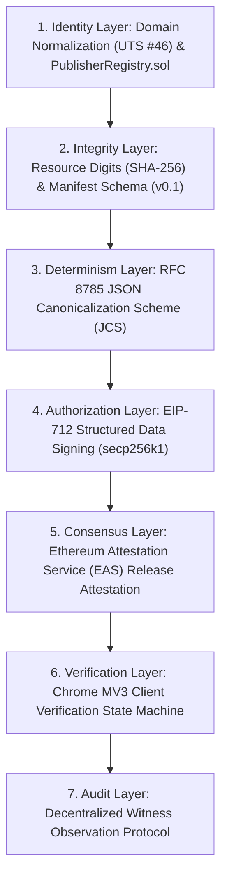

# Protocol Overview — LUCENTRA Protocol v0.1

**Document ID:** LUC-PRO-001  
**Version:** 0.1.0  
**Status:** APPROVED  
**Last Updated:** 2026-11-09  

---

## 1. Purpose

This document provides a high-level technical overview of the **LUCENTRA Protocol v0.1**, defining how decentralized publisher identity, signed release manifests, on-chain EAS attestations, and client verification operate as a unified, open protocol.

---

## 2. Protocol Architectural Layers

---

## 3. Protocol Invariants

1. **Deterministic Representation:** A given release manifest object must serialize to one and only one exact byte string across all compliant implementations.
2. **Immutable Provenance:** Once an EAS attestation is submitted on-chain, it cannot be modified; it can only be revoked or superseded by a newer release attestation.
3. **Non-Custodial Authority:** Only the address authorized in `PublisherRegistry.sol` for a given domain can produce valid release attestations.
4. **Zero Implicit Trust:** Clients must verify the mathematical signature and EAS record; they must not rely solely on the transport server's response.

---

## 4. Subsystem Protocol Specifications

- [docs/04-protocol/PROTOCOL_SPECIFICATION_V0.1.md](PROTOCOL_SPECIFICATION_V0.1.md) — Comprehensive technical spec.
- [docs/04-protocol/MANIFEST_SCHEMA.md](MANIFEST_SCHEMA.md) — JSON schema definition.
- [docs/04-protocol/CANONICALIZATION.md](CANONICALIZATION.md) — RFC 8785 implementation details.
- [docs/04-protocol/SIGNATURE_SPECIFICATION.md](SIGNATURE_SPECIFICATION.md) — EIP-712 hashing & signing parameters.
- [docs/04-protocol/RELEASE_LIFECYCLE.md](RELEASE_LIFECYCLE.md) — State transitions from draft to revocation.
- [docs/04-protocol/VERIFICATION_STATES.md](VERIFICATION_STATES.md) — Client verification state machine.
- [docs/04-protocol/DOMAIN_NORMALIZATION.md](DOMAIN_NORMALIZATION.md) — UTS #46 canonicalization rules.
- [docs/04-protocol/WITNESS_PROTOCOL.md](WITNESS_PROTOCOL.md) — Independent observer format.
- [docs/04-protocol/PROTOCOL_VERSIONING.md](PROTOCOL_VERSIONING.md) — Forward and backwards compatibility rules.

---

## 5. References

- [RFC 8785: JSON Canonicalization Scheme](https://www.rfc-editor.org/rfc/rfc8785.html)
- [EIP-712: Typed structured data hashing and signing](https://eips.ethereum.org/EIPS/eip-712)
- [Ethereum Attestation Service](https://docs.attest.org/)
