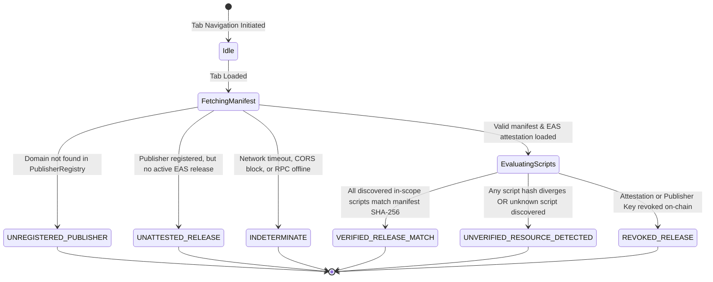

# Protocol Specification v0.1 — LUCENTRA

**Document ID:** LUC-PRO-002  
**Version:** 0.1.0  
**Status:** APPROVED  
**Last Updated:** 2026-11-09  

---

## 1. Specification Objective

This specification formally defines the mathematical algorithms, data structures, type hashes, state machines, and wire formats that constitute the **LUCENTRA Protocol v0.1**.

---

## 2. Mathematical & Cryptographic Definitions

### 2.1 Domain Normalization Function $\mathcal{N}(D)$
Let $D$ be a raw domain string. The normalization function $\mathcal{N}(D)$ converts $D$ to a canonical ASCII string:
$$\mathcal{N}(D) = \text{lower}(\text{ToASCII}(\text{stripTrailingDot}(\text{stripProtocol}(D))))$$
where $\text{ToASCII}$ complies with Unicode UTS #46 / IDNA 2008.

The domain hash $H_D \in \mathbb{B}_{32}$ is computed as:
$$H_D = \text{keccak256}(\text{UTF8}(\mathcal{N}(D)))$$

### 2.2 Asset Hash Function $\mathcal{H}_A(R)$
For any web resource $R$ with byte sequence $B \in \{0, \dots, 255\}^*$:
$$\mathcal{H}_A(R) = \text{SHA-256}(B)$$
Formatted in strings as: `"sha256:" \parallel \text{hex\_lower}(\mathcal{H}_A(R))`

### 2.3 Manifest Hash Function $\mathcal{H}_M(M)$
Let $M$ be a release manifest object conforming to Section 3.
Let $\mathcal{C}(M)$ be the byte string produced by applying the RFC 8785 JSON Canonicalization Scheme to $M$:
$$H_M = \text{SHA-256}(\mathcal{C}(M)) \in \mathbb{B}_{32}$$

### 2.4 EIP-712 Signing Definition
The EIP-712 domain separator $S \in \mathbb{B}_{32}$ is defined as:
$$S = \text{keccak256}(\text{encode}(T_{\text{domain}}, \text{keccak256}(\text{"LUCENTRA"}), \text{keccak256}(\text{"1"}), \text{chainId}, \text{verifyingContract}))$$

The type string for release manifests is:
$$T_{\text{type}} = \text{"ReleaseManifest(string domain,string version,bytes32 manifestHash,uint64 timestamp,uint64 expiresAt)"}$$
The type hash $H_T = \text{keccak256}(T_{\text{type}})$.

The structured hash of manifest $M$ is:
$$H_{\text{struct}} = \text{keccak256}(\text{encode}(H_T, \text{keccak256}(\text{UTF8}(\mathcal{N}(M.\text{domain}))), \text{keccak256}(\text{UTF8}(M.\text{version})), H_M, M.\text{timestamp}, M.\text{expiresAt}))$$

The final EIP-712 signing digest $D_{\text{sign}}$ is:
$$D_{\text{sign}} = \text{keccak256}(\text{bytes2}(0x1901) \parallel S \parallel H_{\text{struct}})$$

The signature $\sigma \in \mathbb{B}_{65}$ is generated by the publisher's secp256k1 private key $k_{\text{pub}}$:
$$\sigma = \text{ECDSA\_sign}(k_{\text{pub}}, D_{\text{sign}})$$

---

## 3. Data Wire Formats

### 3.1 Canonical Release Manifest Wire Format
```json
{
  "schemaVersion": "LUCENTRA-Manifest-v0.1",
  "domain": "app.example.com",
  "version": "1.4.2",
  "createdAt": 1731196800,
  "expiresAt": 1762732800,
  "resources": [
    {
      "path": "/_next/static/chunks/main-app-04f7a.js",
      "size": 145028,
      "sha256": "sha256:e3b0c44298fc1c149afbf4c8996fb92427ae41e4649b934ca495991b7852b855",
      "type": "script"
    },
    {
      "path": "/_next/static/chunks/framework-8c291.js",
      "size": 89230,
      "sha256": "sha256:ca978112ca1bbdcafac231b39a23dc4da786eff8147c4e72b9807785afee48bb",
      "type": "script"
    }
  ]
}
```

### 3.2 EAS Attestation Schema Definition
Registered EAS Schema String:
```solidity
bytes32 manifestHash, string domain, string version, bytes signature
```

---

## 4. Client Verification State Transitions



---

## 5. Security & Invariant Rules

1. **Ordering Invariance:** Even if an application reorders its `<script>` tags in the HTML, verification succeeds as long as all loaded scripts exist with matching hashes in the manifest.
2. **Strict Inclusivity:** If a script tag executes in the browser whose path/content is **not** declared in the manifest, the state machine must immediately transition to `UNVERIFIED_RESOURCE_DETECTED`.
3. **Expiration Boundary:** If `current_timestamp > expiresAt`, the manifest is deemed expired, transitioning to `UNATTESTED_RELEASE` until a renewed release is attested.
4. **Execution Layer Distinction:** Verification operates across Layers 1–6 (DOM script discovery and independent retrieval/comparison). It does not claim Layer 7 verification (in-memory V8 engine JIT byte inspection or inline dynamic `eval()` execution).

---

## 6. Related Documents

- [docs/04-protocol/MANIFEST_SCHEMA.md](MANIFEST_SCHEMA.md)
- [docs/04-protocol/CANONICALIZATION.md](CANONICALIZATION.md)
- [docs/05-cryptography/EIP712_SIGNING.md](../05-cryptography/EIP712_SIGNING.md)

---

## 7. References

- [RFC 8785: JSON Canonicalization Scheme](https://www.rfc-editor.org/rfc/rfc8785.html)
- [EIP-712 Standard](https://eips.ethereum.org/EIPS/eip-712)

