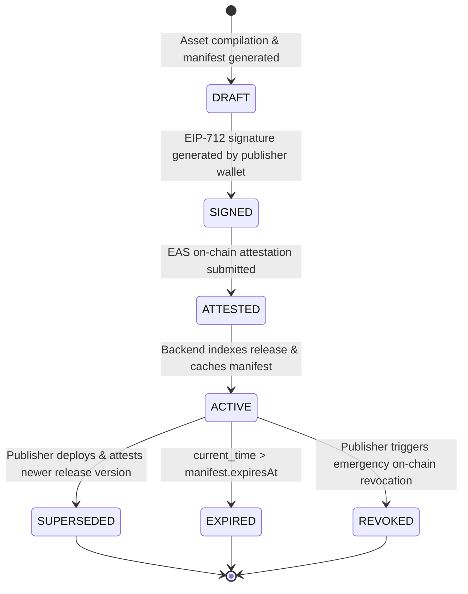

# Release Lifecycle Specification — LUCENTRA

**Document ID:** LUC-PRO-006  
**Version:** 0.1.0  
**Status:** APPROVED  
**Last Updated:** 2026-11-09  

---

## 1. Purpose

This document specifies the complete lifecycle of a web application release under the LUCENTRA protocol, from initial build compilation to active verification, obsolescence, and emergency revocation.

---

## 2. Release State Machine

---

## 3. Lifecycle Phases & Transitions

### Phase 1: DRAFT
- Assets are compiled in the publisher's build pipeline (`npm run build`).
- Release manifest is populated with relative paths and SHA-256 digests.
- Manifest is canonicalized via RFC 8785. Root `manifestHash` is generated.

### Phase 2: SIGNED
- The publisher signs the `manifestHash` via EIP-712 structured typed signature using their authorized secp256k1 key.

### Phase 3: ATTESTED
- An on-chain EAS attestation is submitted to Ethereum / Arbitrum containing the schema data:
  `bytes32 manifestHash, string domain, string version, bytes signature`.
- An immutable 32-byte Attestation UID is minted by the EAS contract.

### Phase 4: ACTIVE
- Manifest and Attestation UID are published to the LUCENTRA backend API.
- Client browser extensions receive this release as the authoritative verification target for the domain.

### Phase 5: SUPERSEDED / EXPIRED / REVOKED
- **SUPERSEDED:** An attestation referencing a higher semantic version or newer timestamp becomes the default active release.
- **EXPIRED:** Manifest reaches its designated expiration timestamp.
- **REVOKED:** In an incident (e.g. compromised CDN or signing key), the publisher executes an on-chain revocation on EAS or `PublisherRegistry.sol`. All client extensions immediately flag the site as `REVOKED`.

---

## 4. Related Documents

- [docs/04-protocol/VERIFICATION_STATES.md](VERIFICATION_STATES.md)
- [docs/05-cryptography/KEY_ROTATION_AND_REVOCATION.md](../05-cryptography/KEY_ROTATION_AND_REVOCATION.md)

---

## 5. References

- [EAS Revocation Documentation](https://docs.attest.org/docs/core--concepts/revocations)

