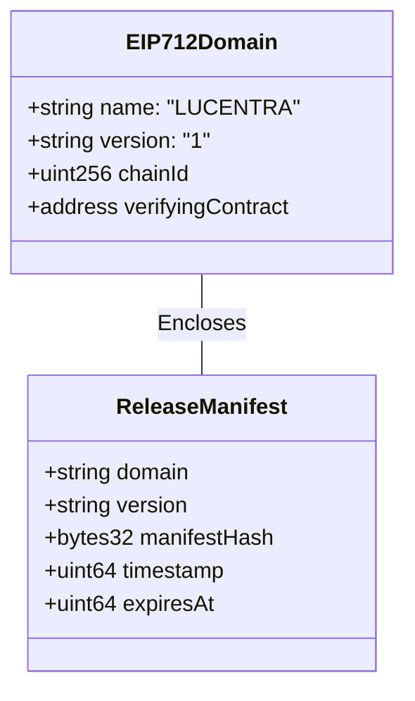

# Signature Specification (EIP-712) — LUCENTRA

**Document ID:** LUC-PRO-005  
**Version:** 0.1.0  
**Status:** APPROVED  
**Last Updated:** 2026-11-09  

---

## 1. Purpose

This document details the exact cryptographic signature specification for release authorization using EIP-712 structured data signing.

---

## 2. EIP-712 Structural Schema



### 2.1 EIP-712 Type Definitions

```solidity
// Type string:
// "EIP712Domain(string name,string version,uint256 chainId,address verifyingContract)"
bytes32 public constant EIP712_DOMAIN_TYPEHASH = keccak256(
    "EIP712Domain(string name,string version,uint256 chainId,address verifyingContract)"
);

// Type string:
// "ReleaseManifest(string domain,string version,bytes32 manifestHash,uint64 timestamp,uint64 expiresAt)"
bytes32 public constant RELEASE_MANIFEST_TYPEHASH = keccak256(
    "ReleaseManifest(string domain,string version,bytes32 manifestHash,uint64 timestamp,uint64 expiresAt)"
);
```

### 2.2 Viem TypeScript Implementation Structure
```typescript
export const lucentraEip712Domain = (chainId: number, verifyingContract: `0x${string}`) => ({
  name: "LUCENTRA",
  version: "1",
  chainId,
  verifyingContract,
} as const);

export const lucentraEip712Types = {
  ReleaseManifest: [
    { name: "domain", type: "string" },
    { name: "version", type: "string" },
    { name: "manifestHash", type: "bytes32" },
    { name: "timestamp", type: "uint64" },
    { name: "expiresAt", type: "uint64" },
  ],
} as const;
```

---

## 3. Signature Verification & Recovery

In Solidity:
```solidity
function verifyReleaseSignature(
    string calldata domain,
    string calldata version,
    bytes32 manifestHash,
    uint64 timestamp,
    uint64 expiresAt,
    bytes calldata signature,
    address expectedSigner
) public view returns (bool) {
    bytes32 structHash = keccak256(
        abi.encode(
            RELEASE_MANIFEST_TYPEHASH,
            keccak256(bytes(domain)),
            keccak256(bytes(version)),
            manifestHash,
            timestamp,
            expiresAt
        )
    );
    bytes32 digest = _hashTypedDataV4(structHash);
    address recoveredSigner = ECDSA.recover(digest, signature);
    return recoveredSigner == expectedSigner;
}
```

---

## 4. Related Documents

- [docs/05-cryptography/EIP712_SIGNING.md](../05-cryptography/EIP712_SIGNING.md)
- [docs/05-cryptography/SIGNATURE_VERIFICATION.md](../05-cryptography/SIGNATURE_VERIFICATION.md)

---

## 5. References

- [EIP-712: Ethereum Typed Structured Data Hashing and Signing](https://eips.ethereum.org/EIPS/eip-712)

