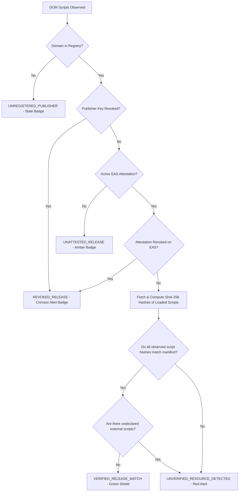

# Verification States Specification — LUCENTRA

**Document ID:** LUC-PRO-007  
**Version:** 0.2.0  
**Status:** APPROVED  
**Last Updated:** 2026-11-09  

---

## 1. Purpose

This document defines the formal verification states evaluated by the LUCENTRA Chrome Extension and verification clients, outlining exact transition criteria, UI badging behaviors, and honest user-facing security messages.

---

## 2. Verification States Taxonomy

| State | Badge Color | Icon Symbol | Severity | Technical Meaning & Honest Boundary |
| :--- | :--- | :--- | :--- | :--- |
| **`VERIFIED_RELEASE_MATCH`** | Emerald Green | Shield 🛡️ / Check ✓ | Informational | All discovered external scripts match the publisher's signed release manifest based on out-of-band resource retrieval and SHA-256 comparison. |
| **`UNVERIFIED_RESOURCE_DETECTED`** | Rose Red | Warning Triangle ⚠️ / Exclamation ! | **CRITICAL** | One or more discovered scripts fail to match declared SHA-256 hashes, or an unknown/unauthorized script URL was loaded into the DOM. |
| **`UNREGISTERED_PUBLISHER`** | Neutral Slate | Outlined Circle ⚪ / Dash — | Neutral | The domain has no registered publisher record in `PublisherRegistry.sol`. |
| **`UNATTESTED_RELEASE`** | Amber Alert | Half-Filled Circle 🟡 | Caution | The domain has a registered publisher, but no active release attestation has been published. |
| **`REVOKED_RELEASE`** | Crimson Red | Skull / Ban 🚫 | **HIGH** | The active release attestation or the publisher's signing key has been explicitly revoked on-chain. |
| **`INDETERMINATE`** | Purple Caution | Question Mark ❓ | Caution | Verification could not complete due to network isolation, RPC timeout, or browser extension sandbox errors. |

---

## 3. Honest Verification Boundary Disclaimer

> **IMPORTANT ARCHITECTURAL NOTICE:**  
> Verification states reflect cryptographic cross-referencing between out-of-band retrieved resource hashes and publisher-attested manifests. The Chrome Extension operates within the browser extension sandbox and **does not verify exact in-memory JIT bytes executed inside the V8 engine**. Independent witness observations and on-chain attestations provide external auditability against split-view edge attacks.

---

## 4. State Evaluation Logic

---

## 5. UI Warning Behaviors on `UNVERIFIED_RESOURCE_DETECTED`

When the client transitions to `UNVERIFIED_RESOURCE_DETECTED`:
1. The extension action badge displays a red `!` badge and pulses.
2. Clicking the extension popup reveals an explicit diagnostic breakdown:
   - "POTENTIAL SCRIPT TAMPERING OR UNLISTED SCRIPT DETECTED"
   - Specific URL(s) of unauthorized or modified scripts.
   - Expected hash vs Observed hash.
   - Actionable advice: "Do not connect your wallet or enter sensitive credentials on this page."

---

## 6. Related Documents

- [docs/09-browser-extension/BROWSER_LIMITATIONS.md](../09-browser-extension/BROWSER_LIMITATIONS.md)
- [docs/09-browser-extension/VERIFICATION_WORKFLOW.md](../09-browser-extension/VERIFICATION_WORKFLOW.md)
- [docs/04-protocol/RELEASE_LIFECYCLE.md](RELEASE_LIFECYCLE.md)

---

## 7. References

- [Chrome Extension Action Badging API](https://developer.chrome.com/docs/extensions/reference/api/action)
