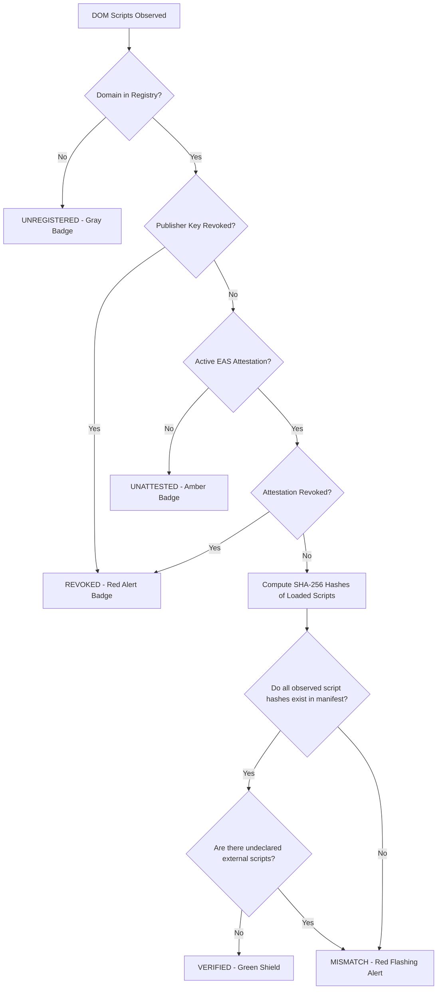

# Verification States Specification — LUCENTRA

**Document ID:** LUC-PRO-007  
**Version:** 0.1.0  
**Status:** APPROVED  
**Last Updated:** 2026-11-09  

---

## 1. Purpose

This document defines the formal verification states evaluated by the LUCENTRA Chrome Extension and verification clients, outlining exact transition criteria, UI badging behaviors, and user threat alerts.

---

## 2. Verification States Taxonomy

| State | Badge Color | Icon Symbol | Severity | Technical Definition |
| :--- | :--- | :--- | :--- | :--- |
| **VERIFIED** | Green | Shield 🛡️ | Informational | 100% of detected DOM scripts match the active EAS-attested release manifest signed by the authorized domain publisher. |
| **MISMATCH** | Red | Warning Triangle ⚠️ | **CRITICAL** | One or more executed scripts fail to match declared SHA-256 hashes, or an unknown/unauthorized script was injected into the DOM. |
| **UNREGISTERED** | Gray | Outlined Circle ⚪ | Neutral | The domain has no registered publisher record in `PublisherRegistry.sol`. |
| **UNATTESTED** | Amber | Half-Filled Circle 🟡 | Low / Caution | The domain has a registered publisher, but no active release attestation has been published. |
| **REVOKED** | Red / Black | Skull / Ban 🚫 | **HIGH** | The active release attestation or the publisher's signing key has been revoked on-chain. |
| **INDETERMINATE** | Purple | Question Mark ❓ | Caution | Verification could not complete due to network isolation, RPC timeout, or browser extension sandbox errors. |

---

## 3. State Evaluation Logic

---

## 4. UI Warning Behaviors on `MISMATCH`

When the client transitions to `MISMATCH`:
1. The extension action badge displays a red `!` badge and pulses.
2. If the user clicks the extension popup, a high-visibility security dialog displays:
   - "POTENTIAL SCRIPT TAMPERING DETECTED"
   - Specific URL(s) of unauthorized or modified scripts.
   - Expected hash vs Observed hash.
   - Recommended action: "Do not connect your wallet or enter sensitive credentials on this page."

---

## 5. Related Documents

- [docs/04-protocol/RELEASE_LIFECYCLE.md](RELEASE_LIFECYCLE.md)
- [docs/09-browser-extension/VERIFICATION_WORKFLOW.md](../09-browser-extension/VERIFICATION_WORKFLOW.md)

---

## 6. References

- [Chrome Extension Action Badging API](https://developer.chrome.com/docs/extensions/reference/api/action)
