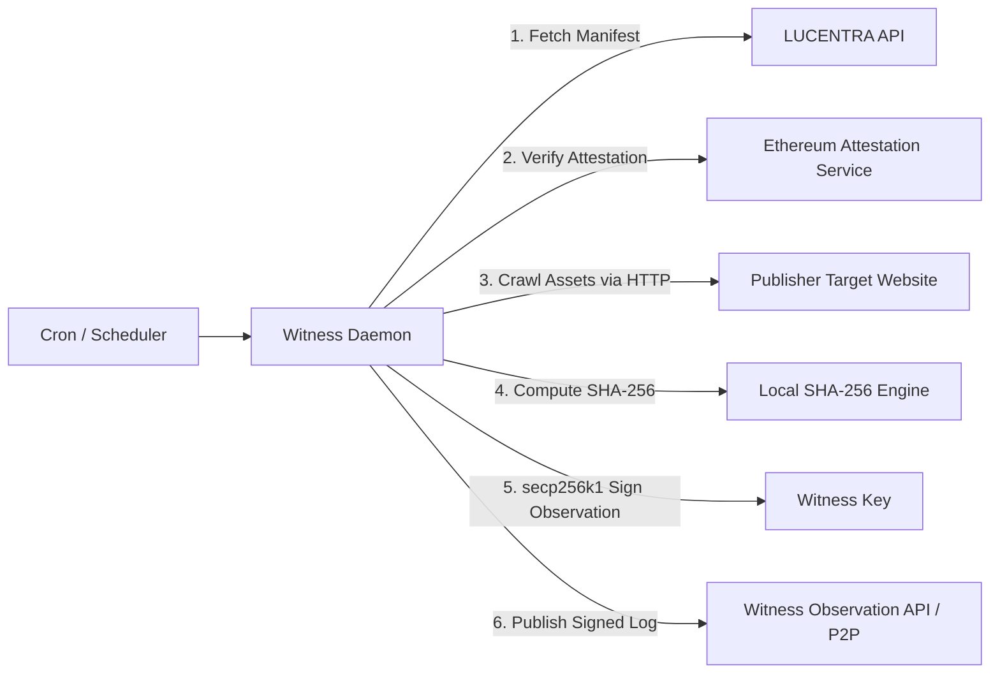

# Witness Protocol Specification (v0.1) — LUCENTRA

**Document ID:** LUC-PRO-009  
**Version:** 0.1.0  
**Status:** APPROVED  
**Last Updated:** 2026-11-09  

---

## 1. Purpose

This document defines the communication protocol, data formats, and cryptographic signing standards used by independent witness nodes to publish observation logs and detect split-view attacks.

---

## 2. Witness Node Architecture



---

## 3. Observation Wire Format

Every observation published by a witness node must conform to the following schema:

```json
{
  "schemaVersion": "LUCENTRA-Witness-v0.1",
  "witnessAddress": "0x1234567890123456789012345678901234567890",
  "domain": "app.example.com",
  "easAttestationUid": "0x456def789abc0123456789abcdef0123456789abcdef0123456789abcdef0123",
  "manifestHash": "0xe3b0c44298fc1c149afbf4c8996fb92427ae41e4649b934ca495991b7852b855",
  "observedAt": 1731196850,
  "crawlerGeo": "US-EAST",
  "status": "CONSISTENT",
  "observedResources": [
    {
      "path": "/_next/static/chunks/main.js",
      "sha256": "sha256:e3b0c44298fc1c149afbf4c8996fb92427ae41e4649b934ca495991b7852b855",
      "matched": true
    }
  ],
  "signature": "0x789abc..."
}
```

---

## 4. Cryptographic Non-Repudiation

1. The witness canonicalizes the observation JSON (excluding `signature`) using RFC 8785.
2. The witness signs the canonical observation hash using their registered secp256k1 private key.
3. Observers and the backend API verify that `witnessAddress` recovered from `signature` is an authorized, active witness node.

---

## 5. Related Documents

- [docs/10-witness-network/WITNESS_ARCHITECTURE.md](../10-witness-network/WITNESS_ARCHITECTURE.md)
- [docs/10-witness-network/CONFLICT_RESOLUTION.md](../10-witness-network/CONFLICT_RESOLUTION.md)

---

## 6. References

- [RFC 8785: JSON Canonicalization Scheme](https://www.rfc-editor.org/rfc/rfc8785.html)

