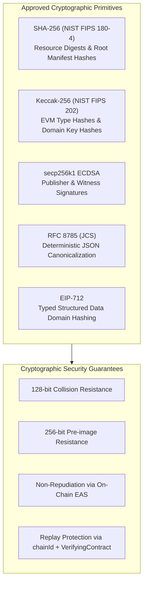

# Cryptographic Architecture — LUCENTRA

**Document ID:** LUC-CRY-001  
**Version:** 0.1.0  
**Status:** APPROVED  
**Last Updated:** 2026-11-09  

---

## 1. Purpose

This document specifies the cryptographic architecture of LUCENTRA, defining the selection, composition, and security boundaries of all cryptographic primitives, algorithms, and key lifecycle operations.

---

## 2. Cryptographic Primitives Composition

---

## 3. Cryptographic Standards Selection Justification

| Primitive | Standard | Specific Application in LUCENTRA | Security Level / Rationale |
| :--- | :--- | :--- | :--- |
| **SHA-256** | NIST FIPS 180-4 | Asset byte stream hashing; manifest root digest | 128-bit collision resistance; hardware accelerated in browser WebCrypto API. |
| **Keccak-256** | Ethereum Standard | Domain normalization hash; EIP-712 type hashing | Native EVM gas efficiency; 128-bit collision resistance. |
| **secp256k1** | SEC 2 / ANSI X9.62 | Publisher release signatures; witness signatures | Ethereum standard; compatible with hardware wallets (Ledger, Trezor). |
| **RFC 8785** | IETF RFC 8785 | Manifest JSON canonicalization prior to hashing | Eliminates JSON serialization ambiguity and signature malleability. |
| **EIP-712** | ERC Standard | Release authorization payload formatting | Prevents signature replay across chains and contracts; human readable. |

---

## 4. Key Management Principles

1. **Non-Custodial Architecture:** Publisher private keys remain exclusively in client custody (hardware wallet, browser extension wallet, or local CI HSM). The LUCENTRA backend server never stores or handles private keys.
2. **Key Separation:** Domain administrative ownership (capable of registering and revoking keys) is separated from daily release signing keys.
3. **Immediate Revocation:** Key revocation transactions executed on `PublisherRegistry.sol` take immediate effect and invalidate active cached attestations.

---

## 5. Related Documents

- [docs/05-cryptography/SHA256_IMPLEMENTATION.md](SHA256_IMPLEMENTATION.md)
- [docs/05-cryptography/EIP712_SIGNING.md](EIP712_SIGNING.md)
- [docs/05-cryptography/KEY_MANAGEMENT.md](KEY_MANAGEMENT.md)

---

## 6. References

- [NIST FIPS 180-4: Secure Hash Standard](https://csrc.nist.gov/pubs/fips/180-4/upd1/final)
- [EIP-712 Standard](https://eips.ethereum.org/EIPS/eip-712)
