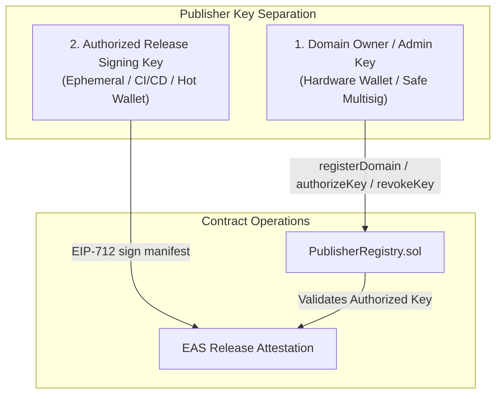

# Key Management & Non-Custodial Architecture — LUCENTRA

**Document ID:** LUC-CRY-005  
**Version:** 0.1.0  
**Status:** APPROVED  
**Last Updated:** 2026-11-09  

---

## 1. Purpose

This document articulates the non-custodial key management architecture governing publisher identities, signing keys, and witness credentials within LUCENTRA.

---

## 2. Key Separation Model

To prevent single points of failure, LUCENTRA enforces a two-tier key hierarchy:

### 2.1 Domain Owner Key (Admin Key)
- **Role:** Possesses primary ownership of the domain record in `PublisherRegistry.sol`.
- **Capabilities:** Authorizes new signing keys, revokes compromised signing keys, updates metadata, or transfers domain ownership.
- **Recommended Storage:** Cold storage (Ledger, Trezor) or multi-signature contract (Gnosis Safe).

### 2.2 Authorized Release Signing Key (Operational Key)
- **Role:** Dedicated operational key used in day-to-day release authorization.
- **Capabilities:** Limited strictly to signing release manifests via EIP-712. Cannot reassign domain ownership or authorize other keys.
- **Recommended Storage:** Protected CI/CD secret, Cloud KMS, or hardware security token.

---

## 3. Strict Non-Custodial Invariants

1. **Zero Private Key Storage:** The LUCENTRA backend server, database, Redis cache, and logs must NEVER accept, receive, process, or store private keys.
2. **Client-Side Signing:** All signing operations occur in publisher-controlled environments (browser wallet or publisher CI runner).
3. **Audit Log:** Any key authorization or revocation event is recorded permanently on the Ethereum blockchain.

---

## 4. Related Documents

- [docs/05-cryptography/KEY_ROTATION_AND_REVOCATION.md](KEY_ROTATION_AND_REVOCATION.md)
- [docs/06-blockchain/PUBLISHER_REGISTRY.md](../06-blockchain/PUBLISHER_REGISTRY.md)

---

## 5. References

- [NIST SP 800-57: Recommendation for Key Management](https://csrc.nist.gov/publications/detail/sp/800-57-part-1/rev-5/final)
