# Key Rotation and Revocation Specification — LUCENTRA

**Document ID:** LUC-CRY-006  
**Version:** 0.1.0  
**Status:** APPROVED  
**Last Updated:** 2026-11-09  

---

## 1. Purpose

This document specifies the protocols and state transitions for rotating authorized signing keys and executing emergency key revocations on-chain.

---

## 2. Key Lifecycle State Machine

```mermaid
stateDiagram-v2
    [*] --> UNAUTHORIZED
    UNAUTHORIZED --> ACTIVE : Owner invokes authorizeKey()
    ACTIVE --> ROTATING : New key authorized; migration period active
    ACTIVE --> REVOKED : Owner invokes revokeKey() [EMERGENCY]
    ROTATING --> REVOKED : Legacy key decommissioned
    REVOKED --> [*]
```



---

## 3. On-Chain Key Operations in `PublisherRegistry.sol`

```solidity
event KeyAuthorized(bytes32 indexed domainHash, address indexed signingKey, uint64 authorizedAt);
event KeyRevoked(bytes32 indexed domainHash, address indexed signingKey, uint64 revokedAt);

function authorizeKey(string calldata domain, address signingKey) external onlyDomainOwner(domain) {
    bytes32 dHash = keccak256(bytes(normalize(domain)));
    require(signingKey != address(0), "Invalid key");
    require(domains[dHash].authorizedKeys[signingKey] != KeyStatus.REVOKED, "Cannot reactivate revoked key");
    
    domains[dHash].authorizedKeys[signingKey] = KeyStatus.ACTIVE;
    emit KeyAuthorized(dHash, signingKey, uint64(block.timestamp));
}

function revokeKey(string calldata domain, address signingKey) external onlyDomainOwner(domain) {
    bytes32 dHash = keccak256(bytes(normalize(domain)));
    require(domains[dHash].authorizedKeys[signingKey] == KeyStatus.ACTIVE, "Key not active");
    
    domains[dHash].authorizedKeys[signingKey] = KeyStatus.REVOKED;
    emit KeyRevoked(dHash, signingKey, uint64(block.timestamp));
}
```

---

## 4. Emergency Incident Response SLA

When an operational signing key is suspected of compromise:
1. Publisher owner calls `revokeKey(domain, compromisedKey)`.
2. Transaction confirms on-chain in $\approx 12\text{ seconds}$ (Ethereum L1) or $< 1\text{ second}$ (Arbitrum).
3. Backend indexing worker catches `KeyRevoked` event and clears Redis cache.
4. Client extensions querying EAS attestations cross-reference `isKeyAuthorized()` and flag releases signed by the compromised key as `REVOKED`.

---

## 5. Related Documents

- [docs/05-cryptography/KEY_MANAGEMENT.md](KEY_MANAGEMENT.md)
- [docs/11-security/INCIDENT_RESPONSE.md](../11-security/INCIDENT_RESPONSE.md)

---

## 6. References

- [OpenZeppelin Access Control](https://docs.openzeppelin.com/contracts/5.x/access-control)

