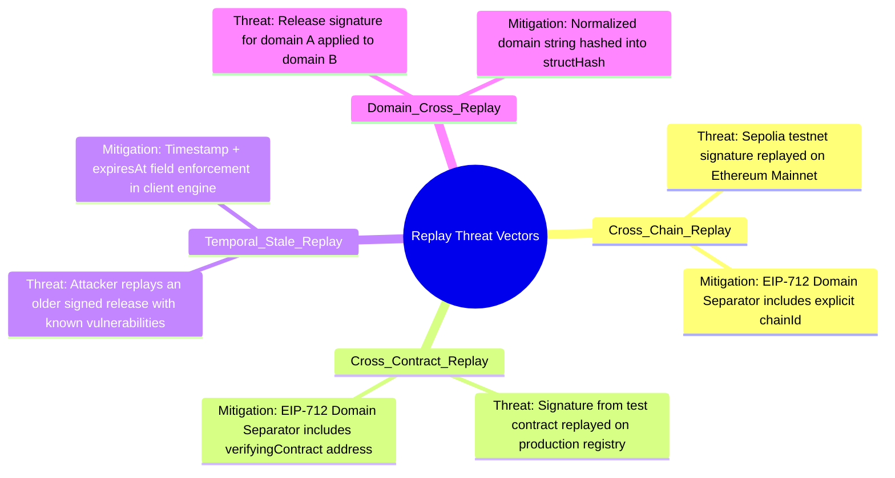

# Replay Protection Architecture — LUCENTRA

**Document ID:** LUC-CRY-007  
**Version:** 0.1.0  
**Status:** APPROVED  
**Last Updated:** 2026-11-09  

---

## 1. Purpose

This document specifies the multi-vector replay protection mechanisms implemented across LUCENTRA to prevent signature replay across different EVM chains, distinct smart contract deployments, or superseded releases.

---

## 2. Replay Threat Vectors & Mitigations

---

## 3. Cryptographic Binding Analysis

### 3.1 Cross-Chain Isolation
Every EIP-712 domain separator incorporates the EVM `chainId` (e.g. `11155111` for Sepolia, `1` for Mainnet, `42161` for Arbitrum One):
$$S = \text{keccak256}(\text{encode}(T_{\text{domain}}, \text{keccak256}(\text{"LUCENTRA"}), \text{keccak256}(\text{"1"}), \mathbf{chainId}, \mathbf{verifyingContract}))$$
Any signature generated for Sepolia will yield an entirely different digest $D_{\text{sign}}$ on Mainnet, causing `ecrecover` to produce an invalid address.

### 3.2 Temporal Replay Defense
Every manifest includes:
- `timestamp`: Unix timestamp when signed.
- `expiresAt`: Unix timestamp when authorization ceases.
Verification clients reject any release where $\text{block.timestamp} > \text{expiresAt}$.

---

## 4. Related Documents

- [docs/04-protocol/SIGNATURE_SPECIFICATION.md](../04-protocol/SIGNATURE_SPECIFICATION.md)
- [docs/05-cryptography/EIP712_SIGNING.md](EIP712_SIGNING.md)

---

## 5. References

- [EIP-712 Standard](https://eips.ethereum.org/EIPS/eip-712)
- [EIP-155: Simple replay attack protection](https://eips.ethereum.org/EIPS/eip-155)
