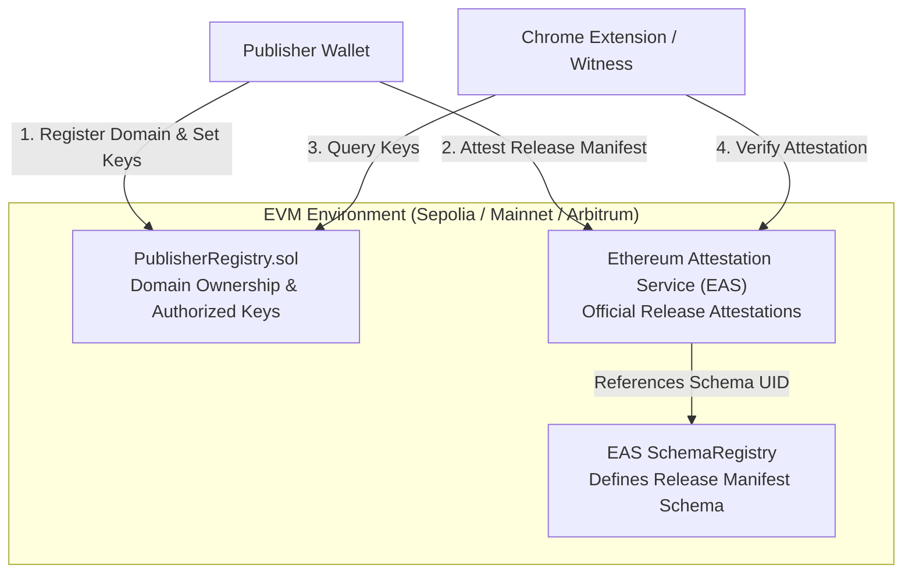

# Blockchain Architecture — LUCENTRA

**Document ID:** LUC-BC-001  
**Version:** 0.1.0  
**Status:** APPROVED  
**Last Updated:** 2026-11-09  

---

## 1. Purpose

This document specifies the blockchain architecture of LUCENTRA, defining EVM smart contract dependencies, on-chain identity models, Ethereum Attestation Service (EAS) integrations, and multi-chain deployment strategies.

---

## 2. On-Chain System Topology

---

## 3. Core Blockchain Principles

1. **Minimal On-Chain Footprint:** Only state that requires cryptographic immutability, censorship resistance, or decentralized consensus is stored on-chain. Large JSON objects and file bytes remain off-chain.
2. **OpenZeppelin Foundations:** Contract implementations utilize OpenZeppelin v5.x contracts for battle-tested access control (`Ownable2Step`), cryptographic signature recovery (`ECDSA`), and reentrancy protection.
3. **Foundry Toolchain:** All smart contracts are developed, fuzz-tested, and deployed exclusively using the Foundry toolchain (`forge`, `cast`, `anvil`).

---

## 4. Multi-Chain Network Strategy

- **Testnet Anchor:** Ethereum Sepolia (`chainId: 11155111`) for development, CI testing, and public testnet verification.
- **Production Anchor:** Arbitrum One (`chainId: 42161`) as primary Layer 2 deployment to achieve sub-dollar transaction fees for publishers, with state bridging / settlement to Ethereum Mainnet (`chainId: 1`).

---

## 5. Related Documents

- [docs/06-blockchain/SMART_CONTRACT_DESIGN.md](SMART_CONTRACT_DESIGN.md)
- [docs/06-blockchain/PUBLISHER_REGISTRY.md](PUBLISHER_REGISTRY.md)
- [docs/06-blockchain/EAS_INTEGRATION.md](EAS_INTEGRATION.md)

---

## 6. References

- [Ethereum Attestation Service Documentation](https://docs.attest.org/)
- [OpenZeppelin Contracts v5.x](https://docs.openzeppelin.com/contracts/5.x/)
- [Foundry Book](https://book.getfoundry.sh/)
