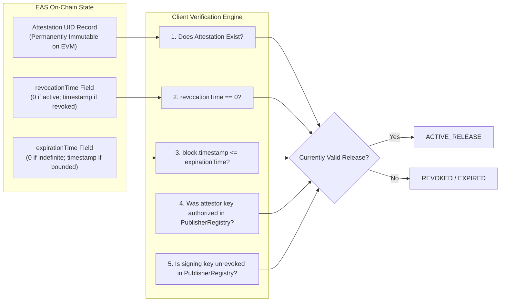

# Ethereum Attestation Service (EAS) Integration & Lifecycle — LUCENTRA

**Document ID:** LUC-BC-004  
**Version:** 0.2.0  
**Status:** APPROVED  
**Last Updated:** 2026-11-09  

---

## 1. Purpose

This document specifies the technical integration between LUCENTRA and the Ethereum Attestation Service (EAS), detailing schema registrations, attestation creation, historical persistence, revocation semantics, expiration, and client verification logic during RPC failures.

---

## 2. Resolving the Immutability vs. Revocation Concept

A foundational architectural concept in EAS is the distinction between **historical persistence** and **current validity**:



1. **Historical Attestation Persistence:** Once submitted to EAS, an attestation record is **permanently immutable**. It exists in Ethereum contract storage and event history forever. No entity—not even the publisher or contract owner—can delete or alter its historical parameters (`manifestHash`, `domain`, `version`, `signature`).
2. **Revocation Semantics:** When an attestation is registered with `revocable = true`, the authorized attestor can invoke `eas.revoke(RevocationRequest)` on-chain. This does **not** erase the attestation; instead, it writes `revocationTime = block.timestamp` onto the attestation's on-chain record.
3. **Expiration:** If an attestation specifies a non-zero `expirationTime`, clients treat the release as expired when `block.timestamp > expirationTime`.
4. **Current Validity Check:** A client evaluates an attestation as currently valid if and only if:
   $$\text{exists}(\text{UID}) \land \text{revocationTime} = 0 \land (\text{expirationTime} = 0 \lor \text{now} \le \text{expirationTime}) \land \text{isKeyAuthorized}(\text{domain}, \text{attester})$$

---

## 3. Official LUCENTRA EAS Schema

### Schema String
```solidity
bytes32 manifestHash, string domain, string version, bytes signature
```

### Schema Parameters
- **`revocable`:** `true` (Mandatory: enables publishers to revoke compromised or corrupted releases immediately on-chain).
- **Resolver Contract:** Optional custom resolver pointing to `PublisherRegistry.sol` to enforce that the attestor must be an authorized key at the block timestamp of attestation.

---

## 4. Submitting & Revoking Attestations (Viem / Ethers)

### 4.1 Submitting a Release Attestation
```typescript
import { EAS, SchemaEncoder } from "@ethereum-attestation-service/eas-sdk";
import { ethers } from "ethers";

const EAS_CONTRACT_ADDRESS_SEPOLIA = "0xC2679fBD37d54388Ce493F1DB75320D236e1815e";
const RELEASE_SCHEMA_UID = "0xYourRegisteredSchemaUidHere...";

export async function submitReleaseAttestation(
  signer: ethers.Signer,
  domain: string,
  version: string,
  manifestHash: `0x${string}`,
  signature: `0x${string}`
): Promise<string> {
  const eas = new EAS(EAS_CONTRACT_ADDRESS_SEPOLIA);
  eas.connect(signer);

  const schemaEncoder = new SchemaEncoder("bytes32 manifestHash, string domain, string version, bytes signature");
  const encodedData = schemaEncoder.encodeData([
    { name: "manifestHash", value: manifestHash, type: "bytes32" },
    { name: "domain", value: domain, type: "string" },
    { name: "version", value: version, type: "string" },
    { name: "signature", value: signature, type: "bytes" },
  ]);

  const tx = await eas.attest({
    schema: RELEASE_SCHEMA_UID,
    data: {
      recipient: ethers.constants.AddressZero,
      expirationTime: 0, // 0 for indefinite until superseded or revoked
      revocable: true,
      data: encodedData,
    },
  });

  return await tx.wait();
}
```

### 4.2 On-Chain Revocation by Publisher
```typescript
export async function revokeReleaseAttestation(
  signer: ethers.Signer,
  attestationUid: string
): Promise<void> {
  const eas = new EAS(EAS_CONTRACT_ADDRESS_SEPOLIA);
  eas.connect(signer);

  const tx = await eas.revoke({
    schema: RELEASE_SCHEMA_UID,
    data: {
      uid: attestationUid,
    },
  });

  await tx.wait();
}
```

---

## 5. Signing-Key Revocation vs. Attestation Revocation

LUCENTRA supports two levels of on-chain revocation:
1. **Release-Level Revocation (via EAS):** The publisher revokes a specific `attestationUID` because a bug or regression was discovered in that specific release. The publisher's signing key remains valid for publishing newer releases.
2. **Key-Level Revocation (via `PublisherRegistry.sol`):** The publisher owner calls `revokeKey(domain, compromisedKey)`. All past and future releases signed by `compromisedKey` are immediately flagged as `REVOKED` by client extensions.

---

## 6. Client Handling of EVM RPC Failures

When the browser extension attempts to verify an attestation on-chain:
1. **Multi-RPC Fallback:** The extension maintains a priority list of public and private RPC endpoints (Infura, Alchemy, Cloudflare, PublicNode). If Endpoint 1 times out ($> 2000\text{ ms}$), it fails over to Endpoint 2.
2. **Cache-Validated Fallback:** If all RPC endpoints are unreachable, the extension checks if an attestation was previously verified and stored in `chrome.storage.local` within a maximum TTL of 24 hours. If found, it displays `VERIFIED_RELEASE_MATCH` with a subtle indicator: *"Cached on-chain state"*.
3. **Graceful Degradation to `INDETERMINATE`:** If the attestation is not in local cache and RPCs fail, the extension **never falsely reports verified or compromised**. It sets status to `INDETERMINATE` with message: *"Unable to verify on-chain attestation due to network connectivity."*

---

## 7. Related Documents

- [docs/06-blockchain/BLOCKCHAIN_ARCHITECTURE.md](BLOCKCHAIN_ARCHITECTURE.md)
- [docs/04-protocol/RELEASE_LIFECYCLE.md](../04-protocol/RELEASE_LIFECYCLE.md)
- [docs/05-cryptography/KEY_ROTATION_AND_REVOCATION.md](../05-cryptography/KEY_ROTATION_AND_REVOCATION.md)

---

## 8. References

- [Ethereum Attestation Service SDK](https://github.com/ethereum-attestation-service/eas-sdk)
- [EAS Revocations Documentation](https://docs.attest.org/docs/core--concepts/revocations)
