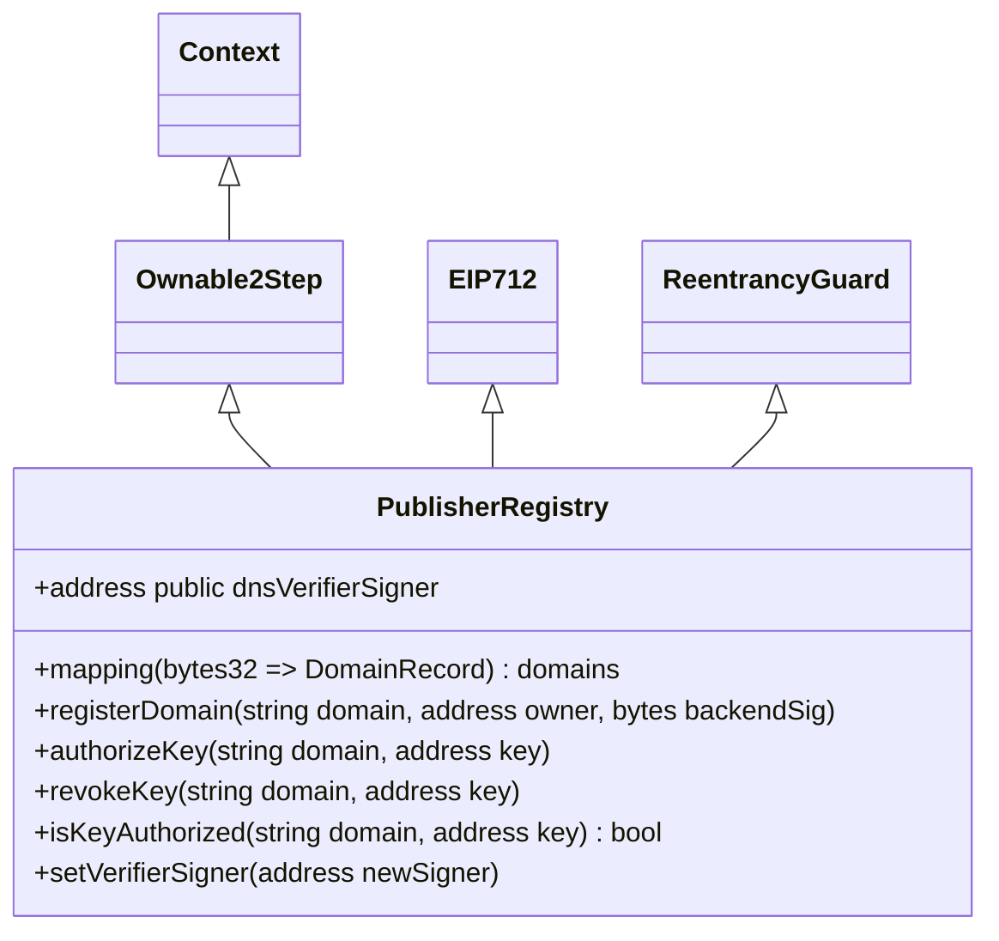

# Smart Contract Design — LUCENTRA

**Document ID:** LUC-BC-002  
**Version:** 0.1.0  
**Status:** APPROVED  
**Last Updated:** 2026-11-09  

---

## 1. Purpose

This document provides the technical design, class hierarchy, and storage layout for the core LUCENTRA smart contract suite.

---

## 2. Contract Inheritance Hierarchy



---

## 3. Storage Layout & Packing Optimization

To minimize SSTORE gas costs, the `DomainRecord` struct is tightly packed:

```solidity
struct DomainRecord {
    address owner;               // 20 bytes (Slot 0)
    uint64 registeredAt;         // 8 bytes  (Slot 0)
    bool isRevoked;              // 1 byte   (Slot 0)
    // 3 bytes padding remaining in Slot 0
    
    string domain;               // Slot 1: Dynamic string
    mapping(address => KeyStatus) authorizedKeys; // Secondary mapping slot
}
```

---

## 4. Security & Reentrancy Design
- All external state-modifying functions follow the Checks-Effects-Interactions (CEI) pattern.
- Critical administrative functions implement `nonReentrant` and `onlyOwner` modifiers.
- Ownership transfers require two-step acceptance via OpenZeppelin `Ownable2Step`.

---

## 5. Related Documents

- [docs/06-blockchain/PUBLISHER_REGISTRY.md](PUBLISHER_REGISTRY.md)
- [docs/06-blockchain/GAS_OPTIMIZATION.md](GAS_OPTIMIZATION.md)

---

## 6. References

- [OpenZeppelin Ownable2Step](https://docs.openzeppelin.com/contracts/5.x/api/access#Ownable2Step)
- [Solidity Storage Layout](https://docs.solidity.org/en/v0.8.24/internals/layout_in_storage.html)
