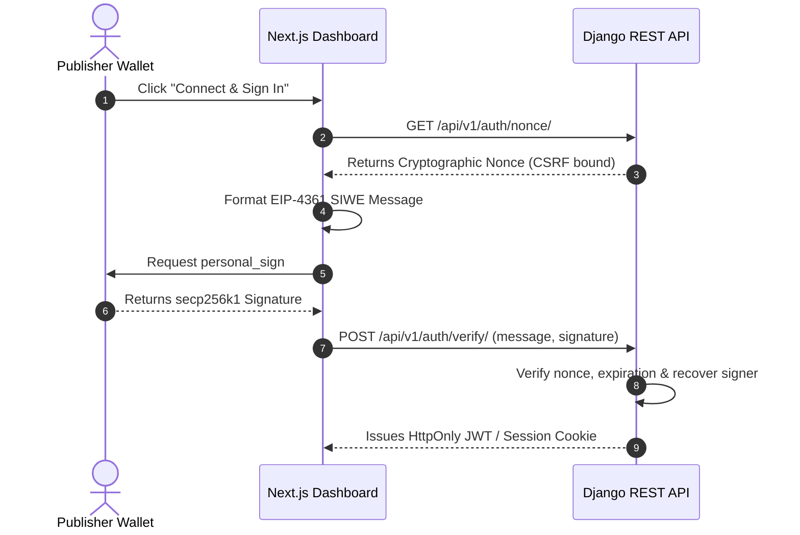

# Authentication Specification (SIWE) — LUCENTRA

**Document ID:** LUC-BE-004  
**Version:** 0.1.0  
**Status:** APPROVED  
**Last Updated:** 2026-11-09  

---

## 1. Purpose

This document details the authentication and authorization architecture for the LUCENTRA Publisher Dashboard, implementing Sign-In with Ethereum (EIP-4361 / SIWE).

---

## 2. SIWE Authentication Flow

---

## 3. Session Security Policies

1. **HttpOnly Cookies:** JWT tokens are transported strictly inside `HttpOnly; Secure; SameSite=Strict` cookies, preventing XSS-based session hijacking.
2. **Short-Lived Tokens:** Access tokens expire after 15 minutes; refresh tokens expire after 7 days and use rotation with automatic reuse detection.
3. **Domain Authorization:** After successful authentication, backend viewsets restrict modifications to domains where `msg.sender == domain.owner_address`.

---

## 4. Related Documents

- [docs/07-backend/API_SPECIFICATION.md](API_SPECIFICATION.md)
- [docs/08-frontend/WALLET_INTEGRATION.md](../08-frontend/WALLET_INTEGRATION.md)

---

## 5. References

- [EIP-4361: Sign-In with Ethereum](https://eips.ethereum.org/EIPS/eip-4361)
