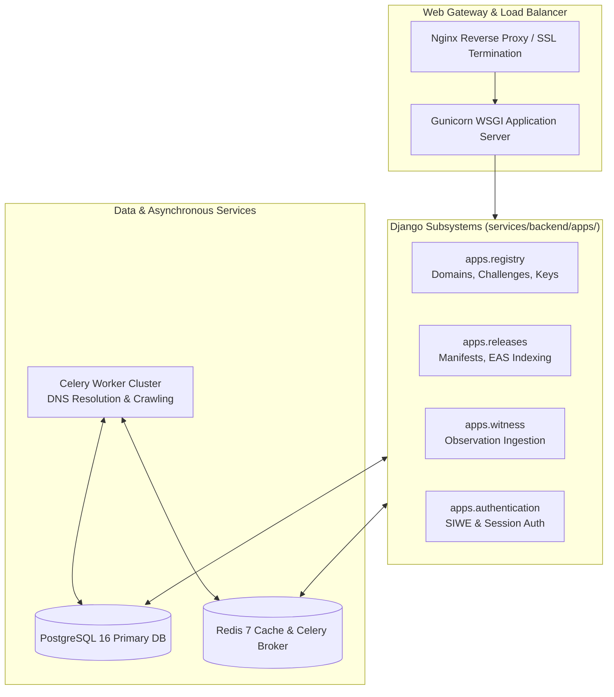

# Backend Architecture (Django REST Framework) — LUCENTRA

**Document ID:** LUC-BE-001  
**Version:** 0.1.0  
**Status:** APPROVED  
**Last Updated:** 2026-11-09  

---

## 1. Purpose

This document specifies the backend service architecture of LUCENTRA, built using Python 3.11+, Django 5+, Django REST Framework (DRF), PostgreSQL, Redis, and Celery.

---

## 2. Subsystem Layout

---

## 3. Core Architectural Modules

1. **`apps.registry`:** Manages domain models, normalization, DNS challenge token generation, and coordination with `PublisherRegistry.sol`.
2. **`apps.releases`:** Ingests RFC 8785 canonical manifests, computes manifest root hashes, validates EAS attestations, and serves cached manifests to browser extensions.
3. **`apps.witness`:** Ingests signed observations from witness nodes, aggregates consensus scores, and triggers split-view alerts.
4. **`apps.authentication`:** Handles Sign-In with Ethereum (EIP-4361 / SIWE) for publisher dashboard API sessions.

---

## 4. Dependencies & Security Implications

- The backend serves as an **acceleration and indexing layer**, not a root of trust.
- The backend signing key for issuing DNS challenge tickets (`dnsVerifierSigner`) is managed via secure environment variables / secret manager and never checked into source control.

---

## 5. Related Documents

- [docs/07-backend/DATABASE_SCHEMA.md](DATABASE_SCHEMA.md)
- [docs/07-backend/API_SPECIFICATION.md](API_SPECIFICATION.md)
- [docs/07-backend/BACKGROUND_JOBS.md](BACKGROUND_JOBS.md)

---

## 6. References

- [Django REST Framework Documentation](https://www.django-rest-framework.org/)
- [Celery Project Documentation](https://docs.celeryq.dev/)
