# Database Schema & Data Models — LUCENTRA

**Document ID:** LUC-BE-002  
**Version:** 0.1.0  
**Status:** APPROVED  
**Last Updated:** 2026-11-09  

---

## 1. Purpose

This document provides the PostgreSQL entity relationship diagram (ERD) and Django model specifications for all database tables in the LUCENTRA backend.

---

## 2. Entity Relationship Diagram (ERD)

```mermaid
erDiagram
    Domain ||--o{ Release : has
    Domain ||--o{ SigningKey : authorizes
    Domain ||--o{ DnsChallenge : issues
    Release ||--o{ Resource : contains
    Release ||--o{ WitnessObservation : audited_by
    WitnessNode ||--o{ WitnessObservation : generates

    Domain {
        uuid id PK
        string normalized_name UK
        string domain_hash UK
        string owner_address
        boolean is_dns_verified
        boolean registered_on_chain
        timestamp created_at
    }

    DnsChallenge {
        uuid id PK
        uuid domain_id FK
        string challenge_token
        timestamp expires_at
        boolean verified
        timestamp verified_at
    }

    SigningKey {
        uuid id PK
        uuid domain_id FK
        string key_address
        string status
        timestamp authorized_at
        timestamp revoked_at
    }

    Release {
        uuid id PK
        uuid domain_id FK
        string version
        string manifest_hash UK
        text canonical_manifest_json
        string eas_attestation_uid UK
        string signing_address
        boolean is_active
        timestamp created_at
    }

    Resource {
        uuid id PK
        uuid release_id FK
        string path
        string sha256
        integer size_bytes
        string resource_type
    }

    WitnessNode {
        uuid id PK
        string node_address UK
        string label
        boolean is_active
        timestamp registered_at
    }

    WitnessObservation {
        uuid id PK
        uuid witness_node_id FK
        uuid release_id FK
        string status
        string crawler_geo
        text raw_observation_json
        string signature
        timestamp observed_at
    }
```

---

## 3. Database Indices & Performance Strategy
- `normalized_name`: Unique B-Tree index for instantaneous manifest lookups.
- `manifest_hash`: Unique index for cryptographic cross-referencing with EAS attestations.
- `eas_attestation_uid`: Unique index for direct attestation lookups.
- Composite index on `(domain_id, is_active)` for fast retrieval of the current active release.

---

## 4. Related Documents

- [docs/07-backend/BACKEND_ARCHITECTURE.md](BACKEND_ARCHITECTURE.md)
- [docs/07-backend/API_SPECIFICATION.md](API_SPECIFICATION.md)

---

## 5. References

- [Django Models Documentation](https://docs.djangoproject.com/en/5.0/topics/db/models/)
- [PostgreSQL Indexing Documentation](https://www.postgresql.org/docs/current/indexes.html)
