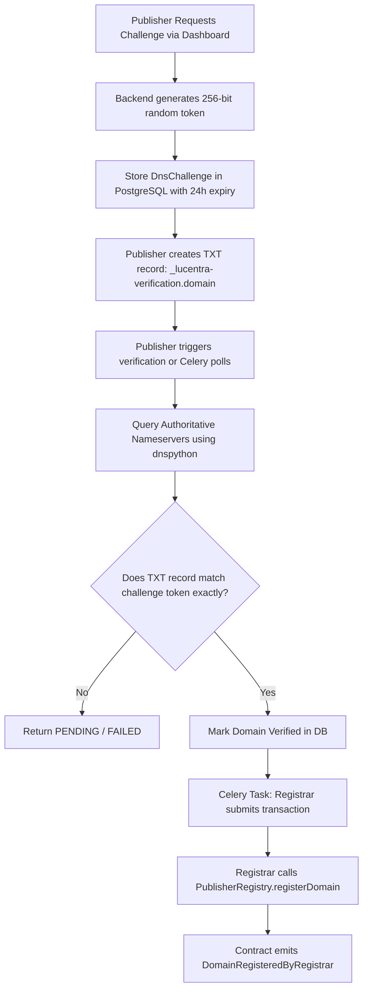

# Domain Verification Engine & Registrar Submission — LUCENTRA

**Document ID:** LUC-BE-005  
**Version:** 0.2.0  
**Status:** APPROVED  
**Last Updated:** 2026-11-09  

---

## 1. Purpose

This document specifies the technical design of the backend domain verification engine and registrar submission worker, explaining how DNS TXT challenges are generated, queried across authoritative nameservers, and submitted on-chain by the authorized registrar role.

---

## 2. DNS Verification & Registrar Submission Pipeline



---

## 3. Authoritative DNS Resolution Algorithm

To prevent DNS cache poisoning and stale resolver responses:
```python
import dns.resolver

def verify_dns_txt_record(domain: str, expected_token: str) -> bool:
    challenge_subdomain = f"_lucentra-verification.{domain}"
    resolver = dns.resolver.Resolver()
    resolver.timeout = 5.0
    resolver.lifetime = 10.0
    
    try:
        answers = resolver.resolve(challenge_subdomain, "TXT")
        for rdata in answers:
            txt_string = "".join(s.decode("utf-8") for s in rdata.strings)
            if txt_string.strip() == f"lucentra-challenge={expected_token}":
                return True
    except (dns.resolver.NXDOMAIN, dns.resolver.NoAnswer, dns.resolver.Timeout):
        return False
        
    return False
```

---

## 4. Registrar On-Chain Submission Task

Once DNS TXT match is confirmed:
```python
@shared_task(bind=True, max_retries=3)
def submit_on_chain_registration(self, domain_id: str):
    domain = Domain.objects.get(id=domain_id)
    if not domain.is_dns_verified:
        return
        
    # Registrar wallet submits transaction to PublisherRegistry.sol
    tx_hash = web3_client.register_domain_as_registrar(
        domain=domain.normalized_name,
        owner=domain.owner_address
    )
    domain.registered_on_chain = True
    domain.save()
```

---

## 5. Related Documents

- [docs/06-blockchain/PUBLISHER_REGISTRY.md](../06-blockchain/PUBLISHER_REGISTRY.md)
- [docs/07-backend/BACKGROUND_JOBS.md](BACKGROUND_JOBS.md)

---

## 6. References

- [dnspython Documentation](https://www.dnspython.org/)
- [RFC 1035: Domain Names](https://www.rfc-editor.org/rfc/rfc1035.html)
