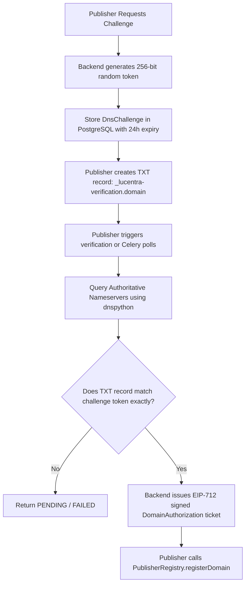

# Domain Verification Engine — LUCENTRA

**Document ID:** LUC-BE-005  
**Version:** 0.1.0  
**Status:** APPROVED  
**Last Updated:** 2026-11-09  

---

## 1. Purpose

This document specifies the technical design of the domain verification engine, explaining how DNS TXT challenges are generated, queried across authoritative nameservers, and validated.

---

## 2. DNS Verification Pipeline



---

## 3. Authoritative DNS Resolution Algorithm

To prevent DNS spoofing and avoid stale intermediate caching:
```python
import dns.resolver

def verify_dns_txt_record(domain: str, expected_token: str) -> bool:
    challenge_subdomain = f"_lucentra-verification.{domain}"
    resolver = dns.resolver.Resolver()
    resolver.timeout = 5.0
    resolver.lifetime = 10.0
    
    try:
        answers = resolver.resolve(challenge_subdomain, "TXT")
        for rdata in answers:
            txt_string = "".join(s.decode("utf-8") for s in rdata.strings)
            if txt_string.strip() == f"lucentra-challenge={expected_token}":
                return True
    except (dns.resolver.NXDOMAIN, dns.resolver.NoAnswer, dns.resolver.Timeout):
        return False
        
    return False
```

---

## 4. Related Documents

- [docs/06-blockchain/PUBLISHER_REGISTRY.md](../06-blockchain/PUBLISHER_REGISTRY.md)
- [docs/07-backend/BACKGROUND_JOBS.md](BACKGROUND_JOBS.md)

---

## 5. References

- [dnspython Documentation](https://www.dnspython.org/)
- [RFC 1035: Domain Names](https://www.rfc-editor.org/rfc/rfc1035.html)
