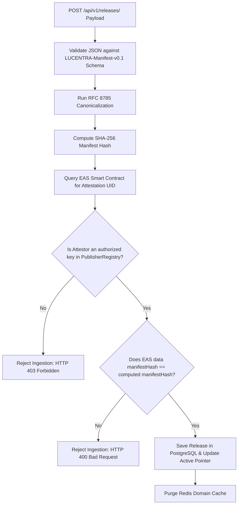

# Release Management & Manifest Ingestion — LUCENTRA

**Document ID:** LUC-BE-006  
**Version:** 0.1.0  
**Status:** APPROVED  
**Last Updated:** 2026-11-09  

---

## 1. Purpose

This document specifies the backend ingestion, validation, and storage pipeline for publisher release manifests.

---

## 2. Ingestion Validation Pipeline

---

## 3. Storage Optimization

The raw canonical manifest JSON is stored in PostgreSQL as `canonical_manifest_json` (Text / JSONB) and indexed in Redis under key `lucentra:manifest:{normalized_domain}:active` with an eviction TTL of 3600 seconds.

---

## 4. Related Documents

- [docs/04-protocol/MANIFEST_SCHEMA.md](../04-protocol/MANIFEST_SCHEMA.md)
- [docs/07-backend/DATABASE_SCHEMA.md](DATABASE_SCHEMA.md)

---

## 5. References

- [Django REST Framework Serializers](https://www.django-rest-framework.org/api-guide/serializers/)

