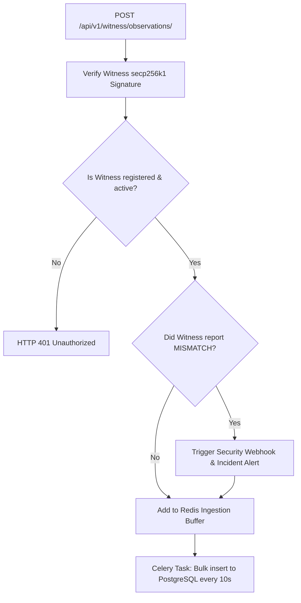

# Witness Management & Observation Ingestion — LUCENTRA

**Document ID:** LUC-BE-008  
**Version:** 0.1.0  
**Status:** APPROVED  
**Last Updated:** 2026-11-09  

---

## 1. Purpose

This document specifies the backend ingestion pipeline for witness observations, defining cryptographic validation, deduplication, and anomaly detection.

---

## 2. Ingestion Pipeline

---

## 3. Split-View Alert Thresholds

If $\ge 2$ independent witness nodes in differing geographical regions report a hash mismatch for an active release within a 15-minute window, the domain verification status is automatically flagged as `UNDER_INVESTIGATION`, and alert notifications are dispatched to the registered publisher's contact channel.

---

## 4. Related Documents

- [docs/10-witness-network/WITNESS_ARCHITECTURE.md](../10-witness-network/WITNESS_ARCHITECTURE.md)
- [docs/10-witness-network/CONFLICT_RESOLUTION.md](../10-witness-network/CONFLICT_RESOLUTION.md)

---

## 5. References

- [Celery Batch Processing](https://docs.celeryq.dev/)

