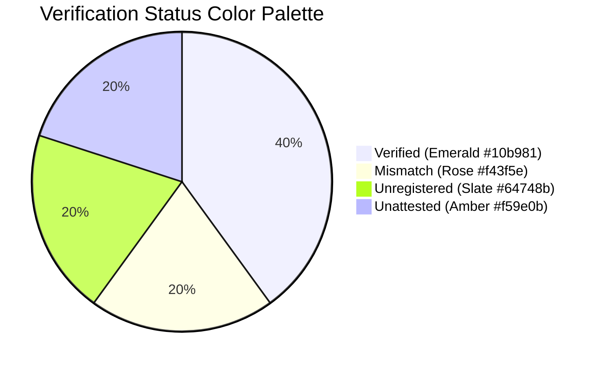

# Design System & UI Tokens — LUCENTRA

**Document ID:** LUC-FE-002  
**Version:** 0.1.0  
**Status:** APPROVED  
**Last Updated:** 2026-11-09  

---

## 1. Purpose

This document establishes the design system, color palette, typography, and UI tokens used across the Next.js Publisher Dashboard and Chrome Extension popup.

---

## 2. Core Color Palette & Verification Status Tokens

| Token Name | Hex Code | Purpose |
| :--- | :--- | :--- |
| `color-verified` | `#10b981` (Emerald 500) | Indicates cryptographic verification success. |
| `color-mismatch` | `#f43f5e` (Rose 500) | Indicates tampering, hash divergence, or unauthorized code. |
| `color-unregistered` | `#64748b` (Slate 500) | Indicates unregistered domain state. |
| `color-unattested` | `#f59e0b` (Amber 500) | Indicates registered publisher without active release. |
| `color-background-dark`| `#090a0f` | Primary dark surface background. |
| `color-surface-card` | `#131722` | Card and modal container background. |
| `color-primary-accent` | `#3b82f6` (Blue 500) | Action buttons and links. |

---

## 3. Typography & Spacing

- **Primary Font:** Inter (`sans-serif`).
- **Code / Cryptographic Hash Font:** JetBrains Mono (`monospace`).
- **Spacing Scale:** Standard 4px grid (Tailwind `p-1`, `p-2`, `p-4`, etc.).

---

## 4. Related Documents

- [docs/08-frontend/FRONTEND_ARCHITECTURE.md](FRONTEND_ARCHITECTURE.md)
- [docs/08-frontend/ACCESSIBILITY.md](ACCESSIBILITY.md)

---

## 5. References

- [Tailwind CSS Documentation](https://tailwindcss.com/docs)

