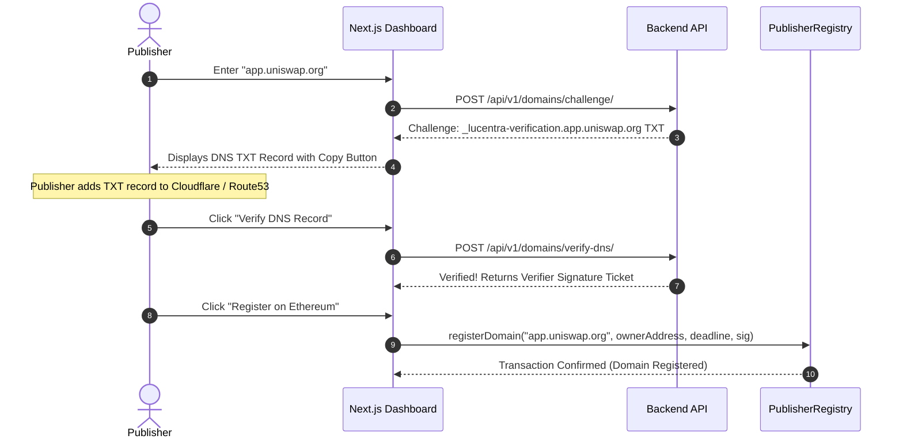

# Publisher Workflows & User Journeys — LUCENTRA

**Document ID:** LUC-FE-005  
**Version:** 0.1.0  
**Status:** APPROVED  
**Last Updated:** 2026-11-09  

---

## 1. Purpose

This document provides step-by-step UX flows for website publishers onboarding domains, signing new releases, and rotating signing keys.

---

## 2. Onboarding Workflow (Domain Verification & Contract Registration)

---

## 3. Release Publication Workflow
1. Publisher navigates to **Releases $\rightarrow$ New Release**.
2. Drags and drops the static build output folder (`dist/` or `out/`).
3. Dashboard scans files, ignores media/CSS, hashes JavaScript files with SHA-256, and outputs canonical JSON.
4. Publisher reviews the asset list, file sizes, and computed root hash.
5. Clicks **"Sign and Attest Release"**.
6. Publisher's Web3 wallet opens with the EIP-712 typed prompt showing domain, version, and `manifestHash`.
7. Once signed, the dashboard submits the EAS attestation transaction.
8. The release is published to the LUCENTRA backend API and goes live instantly.

---

## 4. Related Documents

- [docs/08-frontend/DASHBOARD_COMPONENTS.md](DASHBOARD_COMPONENTS.md)
- [docs/01-product-management/USER_STORIES.md](../01-product-management/USER_STORIES.md)

---

## 5. References

- [Nielsen Norman Group Web UX Patterns](https://www.nngroup.com/)
