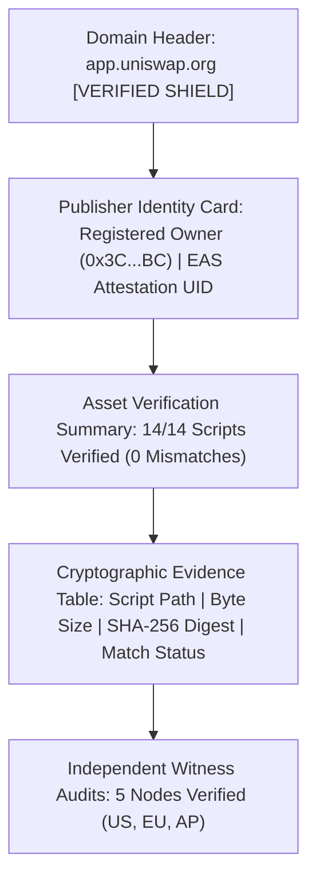

# Verification Report UI & Evidence Presentation — LUCENTRA

**Document ID:** LUC-FE-006  
**Version:** 0.1.0  
**Status:** APPROVED  
**Last Updated:** 2026-11-09  

---

## 1. Purpose

This document specifies the UI layout and evidence presentation design for the public verification report view, accessible via both the Chrome Extension popup and the web dashboard.

---

## 2. Public Verification Report Layout

---

## 3. Evidence Table Columns
1. **Asset Path:** Relative URI of script (e.g. `/_next/static/chunks/main-app.js`).
2. **File Size:** Human-readable bytes (e.g. `142.3 KB`).
3. **Declared Hash:** Expected SHA-256 digest from signed manifest.
4. **Observed Hash:** SHA-256 digest computed in real-time by browser Web Worker.
5. **Status:** Green checkmark (`MATCH`) or Red alert badge (`MISMATCH`).

---

## 4. Related Documents

- [docs/08-frontend/DESIGN_SYSTEM.md](DESIGN_SYSTEM.md)
- [docs/09-browser-extension/VERIFICATION_WORKFLOW.md](../09-browser-extension/VERIFICATION_WORKFLOW.md)

---

## 5. References

- [EAS Explorer Integration](https://easscan.org/)
