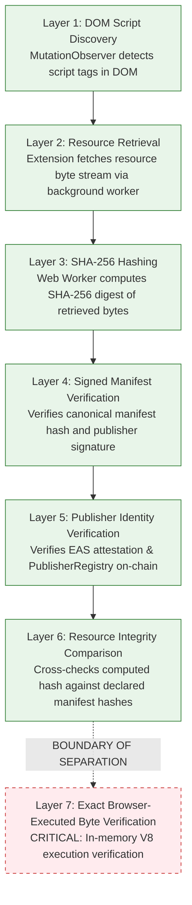

# Browser Limitations, Verification Boundaries & Honest Claims — LUCENTRA

**Document ID:** LUC-EXT-009  
**Version:** 0.2.0  
**Status:** APPROVED  
**Last Updated:** 2026-11-09  

---

## 1. Purpose

This document establishes the formal verification boundaries, browser runtime limitations, and honest security claims of the LUCENTRA Chrome Extension under Chrome Manifest V3. 

It explicitly distinguishes between DOM discovery, out-of-band resource retrieval, cryptographic comparison, and exact browser-executed byte verification.

---

## 2. The Seven Verification Layers (Honest Architectural Breakdown)

The LUCENTRA client verification pipeline is composed of seven distinct layers. Understanding the boundaries between these layers is essential to avoid overstating client security guarantees:

### Layer 1: DOM Script Discovery
The content script observes the document and intercepts ``) have no `src` attribute. While their textual content can be hashed from `textContent`, minor whitespace variations or dynamic server-side template variables can alter the hash between requests. Inline scripts are audited and flagged, but full integrity guarantees apply primarily to external versioned bundles.

### 3.5 Cross-Origin Resource Sharing (CORS) & Redirects
Content scripts attempting to fetch cross-origin resources directly are blocked by CORS. The extension routes all resource retrieval through the background service worker using extension host permissions. If a script URL triggers an HTTP 301/302 redirect, the final resolved URL and response must be recorded and evaluated.

### 3.6 Timing & Pre-Execution Race Conditions
Because Manifest V3 does not support synchronous `webRequestBlocking` for consumer extensions, an external script may begin parsing and executing in the browser before the extension's out-of-band fetch, hash, and on-chain verification complete.  
*Mitigation:* Verification status is surfaced asynchronously; users are cautioned through prominent badging if verification is pending or if a mismatch is detected immediately after load.

---

## 4. Honest Verification States & User-Facing Messaging

To ensure absolute transparency and technical integrity, user-facing verification states are defined with explicit, honest semantics:

| State Identifier | Action Badge | User-Facing Popup Title | Technical Meaning & Honest Boundary |
| :--- | :--- | :--- | :--- |
| **`VERIFIED_RELEASE_MATCH`** | Emerald Green (✓) | **Verified Publisher Release** | All discovered external scripts match the publisher's signed release manifest based on out-of-band resource retrieval and SHA-256 comparison. |
| **`UNVERIFIED_RESOURCE_DETECTED`** | Rose Red (!) | **Unverified Resource Detected** | An executed script's retrieved hash does not match the publisher's signed manifest, or an unauthorized external script URL was loaded into the DOM. |
| **`UNREGISTERED_PUBLISHER`** | Neutral Slate (—) | **Unregistered Domain** | No publisher record found in `PublisherRegistry.sol`. Standard web HTTPS protections apply. |
| **`UNATTESTED_RELEASE`** | Amber Alert (○) | **Unattested Release** | Publisher is registered, but no active EAS release attestation was published for this deployment. |
| **`REVOKED_RELEASE`** | Crimson Alert (🚫) | **Revoked Release / Compromised Key** | The release attestation or publisher signing key has been explicitly revoked on-chain. |
| **`INDETERMINATE`** | Purple Caution (?) | **Verification Incomplete** | Verification could not complete due to network timeout, RPC unavailability, or browser sandbox constraints. |

---

## 5. Related Documents

- [docs/09-browser-extension/EXTENSION_ARCHITECTURE.md](EXTENSION_ARCHITECTURE.md)
- [docs/09-browser-extension/VERIFICATION_WORKFLOW.md](VERIFICATION_WORKFLOW.md)
- [docs/04-protocol/VERIFICATION_STATES.md](../04-protocol/VERIFICATION_STATES.md)
- [docs/11-security/THREAT_MODEL.md](../11-security/THREAT_MODEL.md)

---

## 6. References

- [Chrome Extensions Manifest V3 Overview](https://developer.chrome.com/docs/extensions/mv3/intro/mv3-overview/)
- [W3C Service Workers Specification](https://www.w3.org/TR/service-workers/)
