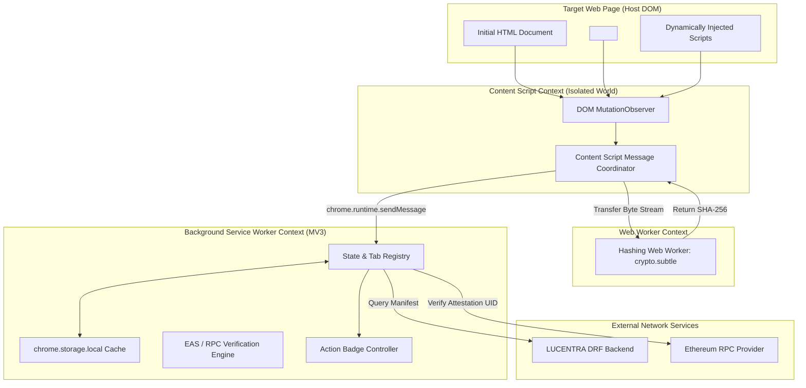

# Browser Extension Architecture (Manifest V3) — LUCENTRA

**Document ID:** LUC-EXT-001  
**Version:** 0.1.0  
**Status:** APPROVED  
**Last Updated:** 2026-11-09  

---

## 1. Purpose

This document specifies the technical architecture of the LUCENTRA Chrome Extension under Google Chrome Manifest V3, outlining execution context boundaries, message passing, and real-time script hashing pipelines.

---

## 2. Extension Architectural Topology

---

## 3. Subsystem Breakdown

1. **Content Script (`content.js`):** Injected at `document_start` into all HTTP/HTTPS web tabs. Instantiates a `MutationObserver` on `document.documentElement` to intercept script elements as soon as they attach to the DOM.
2. **Dedicated Web Worker (`hasher.worker.js`):** Dedicated worker spawned by the content script to execute SHA-256 calculations off the browser main UI thread.
3. **Background Service Worker (`background.js`):** Handles extension lifecycle, coordinates HTTP queries to the backend API, queries EVM RPC providers for EAS attestation validity, and updates the browser action icon and badge text.
4. **Popup UI (`popup.html` / `popup.tsx`):** Compact React/Tailwind application opened when the user clicks the extension icon, rendering domain status, publisher identity, and granular asset verification tables.

---

## 4. Dependencies & Security Implications

- Operates in strict **Isolated World** security sandbox.
- Content scripts cannot access page window variables, and page scripts cannot tamper with extension hashing routines.

---

## 5. Related Documents

- [docs/09-browser-extension/MANIFEST_V3.md](MANIFEST_V3.md)
- [docs/09-browser-extension/PERMISSION_MODEL.md](PERMISSION_MODEL.md)
- [docs/09-browser-extension/VERIFICATION_WORKFLOW.md](VERIFICATION_WORKFLOW.md)

---

## 6. References

- [Google Chrome Extension Manifest V3 Guidelines](https://developer.chrome.com/docs/extensions/mv3/)

