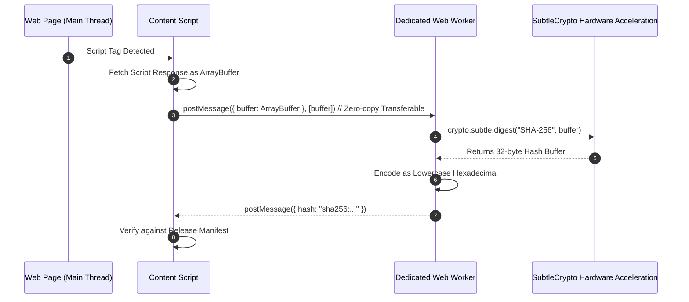

# Resource Hashing & Web Worker Concurrency — LUCENTRA

**Document ID:** LUC-EXT-007  
**Version:** 0.1.0  
**Status:** APPROVED  
**Last Updated:** 2026-11-09  

---

## 1. Purpose

This document specifies the Web Worker execution model for calculating SHA-256 digests in the browser without impacting main thread rendering performance.

---

## 2. Hashing Pipeline Architecture



---

## 3. Zero-Copy Transferable Objects

To avoid memory duplication and performance bottlenecks on large JavaScript bundles:
```typescript
// Content Script transfers buffer ownership to Worker
const buffer = await response.arrayBuffer();
worker.postMessage({ url, buffer }, [buffer]); // Buffer is transferred, zero-copy
```

---

## 4. Related Documents

- [docs/05-cryptography/SHA256_IMPLEMENTATION.md](../05-cryptography/SHA256_IMPLEMENTATION.md)
- [docs/09-browser-extension/RESOURCE_INSPECTION.md](RESOURCE_INSPECTION.md)

---

## 5. References

- [HTML5 Transferable Objects](https://developer.mozilla.org/en-US/docs/Web/API/Web_Workers_API/Transferable_objects)
