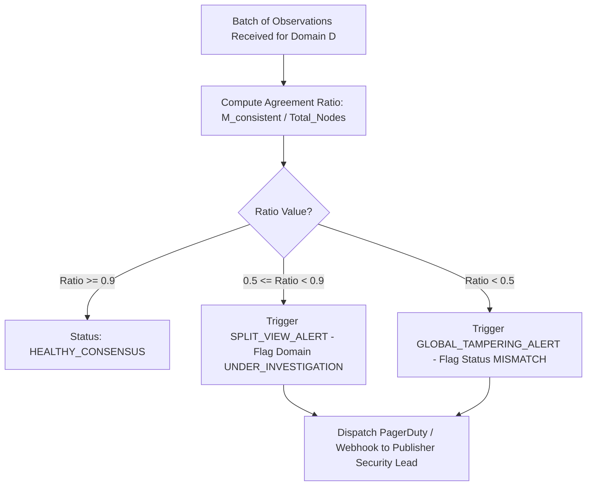

# Conflict Resolution & Split-View Detection — LUCENTRA

**Document ID:** LUC-WIT-005  
**Version:** 0.1.0  
**Status:** APPROVED  
**Last Updated:** 2026-11-09  

---

## 1. Purpose

This document specifies the consensus scoring algorithms, anomaly thresholds, and conflict resolution rules applied when witness observations diverge from publisher attestations or from each other.

---

## 2. Conflict Classification Taxonomy

| Conflict Type | Description | Root Cause Candidates | Severity |
| :--- | :--- | :--- | :--- |
| **Type 1: Global Mismatch** | All witness nodes report hash mismatch against EAS attestation. | Publisher deployed code without publishing an updated release attestation; or host breached globally. | **HIGH** |
| **Type 2: Split-View Discrepancy** | Witness in Region A reports `MATCH`, but Witness in Region B reports `MISMATCH`. | Geo-targeted Magecart skimmer, regional CDN edge poisoning, or rolling deployment propagation delay. | **CRITICAL** |
| **Type 3: Single Node Anomaly** | 9 out of 10 nodes report `MATCH`, 1 node reports `UNREACHABLE` or divergence. | Local ISP routing failure, rogue witness node, or localized network timeout. | **LOW** |

---

## 3. Conflict Resolution Algorithm

---

## 4. Related Documents

- [docs/10-witness-network/WITNESS_ARCHITECTURE.md](WITNESS_ARCHITECTURE.md)
- [docs/11-security/INCIDENT_RESPONSE.md](../11-security/INCIDENT_RESPONSE.md)

---

## 5. References

- [Practical Byzantine Fault Tolerance (Castro & Liskov)](https://pmg.csail.mit.edu/papers/osdi99.pdf)

